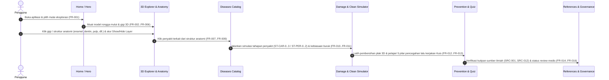

# DOKUMEN RANGKUMAN & SPESIFIKASI SUBMISSION LOGICODIX 2026
> **Status:** Living Document (Wajib diperbarui di setiap iterasi/prompting penambahan fitur, aset, dan konfigurasi)  
> **Standar Rujukan:** Guidebook LOGICODIX 2026 (Halaman 20 - Ketentuan Wajib Dokumentasi & Submission)

---

## 1. Identitas Tim & Anggota
* **Nama Tim:** Tim Sukses
* **Institusi / Universitas:** Telkom University
* **Fakultas / Departemen:** Fakultas Rekayasa Industri
* **Ketua Tim / Penulis Utama:** Muhammad Ahnaf Isa Hammam Lisualla (Kontak: +6281257366106)
* **Daftar Anggota Tim:**
  1. **Muhammad Ahnaf Isa Hammam Lisualla** — Ketua Tim / Product & Strategy Lead
  2. **Muhammad Hafizh Farsya** (NIM: `102022630036`) — UI/UX Designer & Frontend Engineer
  3. **M Alief Ma'rifatullah Az Zikry** (NIM: `102022600457`) — Medical Content & Knowledge Base Researcher
  4. **Muhammad Bevand Januartama** (NIM: `103022630014`, GitHub: `BevandJanuartama`) — Fullstack 3D Engine & AI Engineer

---

## 2. Profil & Konsep Solusi Aplikasi
* **Kategori Aplikasi:** Web App (Interactive 3D Educational Platform)
* **Subtema:** Pendidikan & Kesehatan (*Health & Medical Education*)
* **Nama Aplikasi:** **DentaScope**
* **Masalah yang Diangkat:**
  * **Pernyataan Masalah:** Pelajar, mahasiswa, dan masyarakat umum membutuhkan media edukasi kesehatan gigi yang menyajikan anatomi, penyakit, faktor risiko, dan pencegahan secara terstruktur serta mudah dieksplorasi, tetapi materi konvensional berupa teks dan gambar statis 2D menyulitkan pengguna memahami hubungan spasial antara struktur internal gigi (email, dentin, pulpa, sementum, ligamen periodontal, tulang alveolar) dengan progresi penyakit.
  * **Bukti di Lapangan:** Berdasarkan rujukan WHO (*Oral Health Fact Sheet*) dan Survei Kesehatan Indonesia (SKI) 2023 Kemenkes RI (`SRC-001`, `SRC-010`), beban penyakit gigi dan mulut (khususnya karies dan penyakit periodontal) masih sangat tinggi akibat rendahnya literasi mengenai demineralisasi asam, area rawan plak interdental, serta anggapan keliru bahwa kerusakan gigi bersifat instan atau tidak dapat dicegah pada tahap awal (*white spot lesion*).
* **Deskripsi Solusi:**
  * **DentaScope** adalah platform edukasi kesehatan gigi berbasis web dengan pendekatan visual *hybrid*: menggabungkan model anatomi rongga mulut & gigi 3D prosedural interaktif (dari skala Makro lengkung rahang 32 gigi FDI, Meso fokus gigi, hingga Mikro penampang melintang/*cross-section*) dengan lapisan berwarna, kontrol visibilitas layer, katalog 10 penyakit gigi terverifikasi, *Damage Simulator* (simulasi tahapan klinis Karies `ST-CAR-0..3` & Periodontitis `ST-PER-0..2` serta kebiasaan buruk & Kurva pH Stephan), *Cleaning Simulator* (latihan menyikat gigi, flossing, dan pembersih lidah real-time), materi 5 pilar pencegahan, kuis interaktif, serta sistem tata kelola referensi ilmiah (`SRC-001` s/d `SRC-012`).
* **Target Pengguna:**
  * **Pengguna Primer:** Pelajar, mahasiswa kedokteran gigi/kesehatan, dan masyarakat umum yang ingin mempelajari anatomi serta pencegahan penyakit gigi secara visual.
  * **Pengguna Sekunder:** Tenaga pendidik, penyuluh kesehatan gigi, dan reviewer medis (dokter gigi) yang meninjau akurasi materi edukasi (`Draft | Under Review | Approved`).

---

## 3. Daftar Fitur Utama (MVP Roadmap & Status)
*Catatan: Seluruh fitur di bawah merefleksikan kebutuhan fungsional PRD (`FR-001` s/d `FR-016`) dan Knowledge Base (`03_Dental_Knowledge_Base.xlsx`).*

| No | Fitur Utama | Modul PRD | Deskripsi Alur & Fungsi | Status Implementasi |
|:--:|---|---|---|:--:|
| 1 | **Home & Quick Mode Switcher** | `FR-001` | Pengenalan produk dengan antarmuka krem terang *Ruang Praktik Hangat* (Fase 12) dan navigasi cepat antar-modul | `Selesai (Fase 3)` — Hero + tab Anatomi/Penyakit; tab Simulator/Kuis menyusul Fase 4–5; kerangka shell baru dan onboarding "Kenali gigimu" (Fase 13) |
| 2 | **3D Dental & Mouth Explorer (LOD Makro–Meso–Mikro)** | `FR-002`..`FR-006` | Eksplorasi 3D 32 gigi (FDI), *rotate/zoom/pan/reset*, pemilih mesh berdasarkan object ID, *cutaway cross-section*, dan *Show/Hide Layer Anatomi* | `Selesai (Fase 2)` — engine 3D, raycast 10 struktur + 7 zona rongga mulut, toggle 10 lapisan, cutaway; toolbar vertikal berlabel *Seluruh mulut / Satu gigi / Lapisan dalam* dan framing kamera awal (Fase 13); hotspot coral dan luncuran kamera (Fase 14) |
| 3 | **Katalog Anatomi & Klasifikasi Jenis Gigi** | `FR-007` | Informasi mendalam 10 struktur (`AN-001` Enamel s/d `AN-010` CEJ) & 4 jenis gigi (`TT-001`..`TT-004` sulung vs permanen) beserta meter kerentanan | `Selesai (Fase 3)` — tanpa meter kerentanan (tidak ada di Knowledge Base) |
| 4 | **Katalog 10 Penyakit & Kondisi Gigi** | `FR-008`..`FR-009` | Direktori `DIS-001` s/d `DIS-010` lengkap dengan definisi, faktor risiko, gejala umum, bagian terdampak, pencegahan, *safety note*, dan rujukan `SRC-xxx` | `Selesai (Fase 3)` — + tombol "Lihat di 3D"; "Buka Simulator" di Fase 4; rail per tingkat perhatian, kartu Apa itu / Tanda-tanda / Cara mencegah, dan memilih penyakit memfokuskan kamera (Fase 14) |
| 5 | **Damage Simulator (Tahapan Klinis & Kebiasaan)** | `FR-010`..`FR-011` | Visualisasi tahapan karies (`ST-CAR-0..3`), periodontitis (`ST-PER-0..2`), skenario es batu, bruxism, boba (Kurva pH Stephan), & merokok pada model 3D | `Selesai (Fase 4, redesign Fase 9 & 15)` — rail skenario kiri (`>= 1280px`), penggeser waktu di bawah kanvas dengan tahap tertulis kata, kartu tahap bahasa awam (`plainStages.ts`), Kurva Stephan dilipat ke "Kenapa gula berbahaya?"; partikel es & bakteri belum diport; 4 skenario Stephan masih pola editorial belum bersumber |
| 6 | **3D Cleaning Simulator & 5 Pilar Pencegahan** | `FR-012` | Simulasi interaktif membersihkan plak dengan sikat gigi, benang gigi, & pembersih lidah real-time + materi edukasi `PRE-001`..`PRE-005` | `Selesai (Fase 4, redesign Fase 9 & 15)` — rail 3 kartu alat bergambar besar (`CleanRail`), skor besar warna tinta + 3 batang hijau tebal, timer berhenti di `2:00`, tips teknik di sticky-note kanvas, kamera dari jarak nyaman (`14.5`), 5 pilar pencegahan tanpa kode `PRE-` dipindah ke ringkasan selesai; scaler, kalkulus, dan noda belum ada di logika |
| 7 | **Interactive Dental Quiz** | `FR-013` | Kuis evaluasi pemahaman anatomi, penyakit, dan pencegahan dengan transisi antar soal, umpan balik instan, skor akhir, navigasi keyboard (A–D, 1–4, panah, Enter), pembahasan + tautan referensi, dan sorotan otomatis model 3D ke gigi terkait | `Selesai (Fase 5, redesign Fase 10 & 16)` — layout 2 kolom di desktop (`>= 1280px`) tanpa rail kosong, opsi berhuruf A–D без kode `Q-` dan lencana `Draf`, kamera meluncur ke gigi terkait saat diperiksa (`quizScene.ts`); peta struktur soal Q-001..Q-006 (`lib/data/quizFocus.ts`) belum ditinjau klinisi |
| 8 | **Content Governance & Scientific References** | `FR-014`..`FR-016` | Dialog "Sumber" (12 referensi tanpa kode `SRC-` di tampilan publik, dengan sorotan & scroll otomatis); dialog "Tentang konten ini" dengan kalimat jujur `"0 dari 44 materi sudah ditinjau"` + lipatan "Rincian untuk peninjau" (tab Status materi, Model 3D `AST-001..004`, Celah riset `GAP-001..006`) | `Selesai (Fase 5, redesign Fase 10 & 16)` — palet krem terang (`bg-surface-raised`), status `Draft` ditampilkan sebagai "Belum ditinjau", perubahan status disimpan lokal di peramban |

---

## 4. Arsitektur Teknologi (Tech Stack)
* **Frontend & 3D Engine:**
  * Framework: **Next.js 15** (App Router) + **React 19** + **TypeScript 5.9**
  * 3D Rendering: **Three.js (`0.180`)** + **React Three Fiber (`@react-three/fiber` v9)** + **`@react-three/drei` v10** (Procedural Geometry + Custom GLSL Shaders + Local Clipping Planes + `InstancedMesh` + `PerformanceMonitor`)
  * State Management: **Zustand v5** (Reactive UI store + non-reactive 60 FPS simulation state `sim.ts`)
  * Styling & UI: **Tailwind CSS v4** (`@tailwindcss/postcss`) + Design System Token Tiga Lapis (primitif → semantik → komponen) dengan satu tema krem terang (cream `#FBF5EE`, paper `#FFFCF8`, ink `#2A201B`, coral `#E2643F` non-teks, coral-deep `#A93E1F` untuk teks dan tombol; status ok `#2E7048`, warn `#8F5300`, danger `#B42318`)
  * Tipografi: **`Newsreader`** (display) dan **`Atkinson Hyperlegible Next`** (teks), skala `text-display` / `title` / `subtitle` / `body` (17px) / `caption` (15px)
  * Motion & UI Components: **framer-motion** + komponen dari **21st.dev** (shadcn registry, di-restyle ke token desain)
  * Iconography: **Lucide React** + Custom Clinical Dental SVG Icons
* **Data & Knowledge Base Architecture:**
  * Structured Seed Dataset: TypeScript Knowledge Base (`lib/knowledgeBase.ts` + `lib/data/*.ts`, dihasilkan dari xlsx; kuis diperkaya menjadi 8 soal berstatus `Draft`) yang mengimplementasikan seluruh 11 tabel dari `03_Dental_Knowledge_Base.xlsx` (`tooth_structures`, `tooth_types`, `dental_diseases`, `disease_stages`, `prevention_topics`, `dental_models`, `quiz_questions`, `sources`, `research_gaps`).
* **Deployment & Hosting:**
  * Platform: Vercel / Node.js Server (`npm run build && npm run start`)

---

## 5. Diagram Arsitektur Sistem & Alur Data

### A. Diagram Arsitektur Sistem
```mermaid
graph TD
    User["Pengguna (Desktop / Tablet / Mobile)"]
    UI["Next.js 15 App Router UI Layer (HUD krem)"]
    Store["Zustand Reactive Store & 60FPS Sim State"]
    R3F["React Three Fiber 3D Scene Engine"]
    Proc["Procedural Tooth/Mouth Geometry & Custom Shaders"]
    KB[("Dental Knowledge Base (AN / TT / DIS / ST / PRE / SRC)")]

    User -->|Klik / Geser / Pinch / Gosok| UI
    User -->|Orbit / Raycast Mesh Selection| R3F
    UI -->|Dispatch Action (Mode, Tooth, Stage, Layer, Quiz)| Store
    R3F -->|Select Object ID & Update LOD/Clean Score| Store
    Store -->|Sync State| UI
    Store -->|Uniforms & Clipping Planes| Proc
    Proc -->|Render 60 FPS| R3F
    KB -->|Data Anatomi, Penyakit, Tahap, Kuis & Sumber| UI
```

### B. Alur Perjalanan Pengguna (User Journey sesuai PRD Bagian 6)


---

## 6. Panduan Instalasi, Konfigurasi & Menjalankan Aplikasi

### A. Prasyarat Sistem
* Node.js v18.18.0 atau lebih baru (disarankan v20 atau v22 LTS)
* Paket manajer: `npm`

### B. Langkah Instalasi Dependensi
```bash
# 1. Kloning repositori
git clone https://github.com/BevandJanuartama/logicodix-timsukses.git
cd logicodix-timsukses

# 2. Pasang paket dependensi
npm install
```

### C. Konfigurasi Variabel Lingkungan (`.env.example`)
Aplikasi berjalan secara *self-contained* tanpa ketergantungan kunci API berbayar saat runtime agar dapat diuji secara instan oleh dewan juri:
```bash
cp .env.example .env
```

| Nama Variabel | Wajib / Opsional | Deskripsi & Contoh Nilai |
|---|:---:|---|
| `NEXT_PUBLIC_APP_NAME` | Opsional | Nama aplikasi (`Dental Explorer 3D`) |
| `NEXT_PUBLIC_DEFAULT_REVIEW_FILTER` | Opsional | Filter tata kelola konten (`all` atau `Approved`) |

### D. Menjalankan Aplikasi di Localhost
```bash
# Menjalankan server pengembangan (development)
npm run dev

# Memeriksa tipe TypeScript
npm run typecheck

# Membangun dan menjalankan versi produksi (production build)
npm run build
npm run start
```
Akses aplikasi melalui peramban web di `http://localhost:3000`.

---

## 7. Tata Kelola Konten (Content Governance & Review Mode)
Sesuai kebutuhan `FR-014` dan `FR-015` pada PRD, aplikasi menyertakan fitur **Content Governance & Admin Inspector** yang dapat diakses langsung dari bilah atas tanpa memerlukan login kredensial eksternal:
* **Status Editorial (`review_status`):** Setiap item anatomi, penyakit, tahapan simulasi, dan soal kuis memiliki status `Approved`, `Under Review`, atau `Draft`.
* **Reviewer Mode Toggle:** Pengguna/juri dapat mengalihkan tampilan antara seluruh konten dataset atau memfilter khusus konten berstatus `Approved` serta memeriksa matriks aset 3D (`AST-001`..`AST-004`) dan *Research Gaps* (`GAP-001`..`GAP-006`).

---

## 8. Dokumentasi Arsitektur Komputasi & Visualisasi Prosedural
1. **3D Prosedural Tanpa Beban Aset Eksternal (`NFR-001`):** Seluruh 32 gigi (seri, taring, premolar, geraham) beserta lapisan internal (`enamel`, `dentin`, `pulp` dengan pembuluh arteri/vena/saraf, `cementum`, `pd_ligament`, `alveolar_bone`, `gingiva`, dan lidah) dibangkitkan secara matematis/prosedural menggunakan *lathe profiles* dan *custom GLSL shaders*, menghasilkan waktu muat instan dan performa 60 FPS di perangkat mobile maupun desktop.
2. **Simulasi Biokimia & Klinis Deterministik:** Perhitungan kurva demineralisasi pH plak (Kurva Stephan dengan ambang kritis pH 5,5) serta interpolasi tahapan kerusakan (`ST-CAR-0..3` & `ST-PER-0..2`) dihitung secara deterministik berdasarkan rujukan ilmiah.
3. **Pemetaan Object ID 3D → Knowledge Base (`FR-004`):** Raycast memetakan mesh ke `AN-001..010` (`enamel` = mahkota luar, `cementum` = akar luar, `pulp_chamber`/`root_canal` = rongga pulpa di atas/bawah CEJ, `pulp` = pembuluh & saraf, `cej` = cincin batas email–sementum, `pd_ligament` = cangkang tipis di sekitar akar) serta zona papila, palatum, dasar mulut, dan 4 zona lidah. Lapisan tersembunyi dibuang di shader (`discard` per pita CEJ) dan dilewati raycast sehingga lapisan di bawahnya tetap dapat diklik.
4. **Anggaran Render:** ±41 draw call dan ±58 ribu segitiga per frame pada tampilan makro; geometri prosedural di-cache per gigi, resolusi tinggi hanya untuk gigi terpilih, DPR adaptif via `PerformanceMonitor`.
5. **Batas Keamanan Medis (`NFR-006`):** Seluruh modul menampilkan *Medical Disclaimer* bahwa visualisasi bersifat edukatif dan bukan alat diagnosis mandiri maupun *personal risk scoring*.
6. **Redesign Visual Fase 7 (Geometri Anatomi, Shader Jaringan & Studio Lighting):**
   * **Morfologi mahkota** (`lib/three/crownMorphology.ts`): cusp, fisura, fossa sentral, cingulum, dan marginal ridge dibentuk lewat deformasi vertex prosedural. **Akar** (`lib/three/toothRoots.ts`): bifurkasi/trifurkasi gigi anterior vs posterior (`TT-001..004`) dengan alur furkasi.
   * **Kontur CEJ** (`lib/three/cejContour.ts`): kurva batas email–sementum per jenis gigi, dirender lewat GLSL `CEJ_GLSL`.
   * **Shader email & dentin** (`lib/three/toothShader.ts`, `lib/three/toothOptics.ts`): aproksimasi *subsurface scattering* untuk translusensi mutiara, Fresnel rim-light, dan micro-roughness (`AN-001`, `AN-002`).
   * **Shader gusi** (`lib/three/gingivaShader.ts`, `lib/three/softTissue.ts`): specular *wetness* saliva (Schlick Fresnel) dan rona sehat vs meradang lewat `uGumInflammation` (`AN-010`).
   * **Studio lighting** (`components/three/StudioLights.tsx`): rig tiga titik (key hangat-putih, cool rim dari belakang, warm fill) ditambah hemisphere light; rig berotasi mengikuti azimuth kamera dengan damping.
7. **Redesign Design System & Shell HUD Fase 8 (Token Tiga Lapis, Explore & Katalog Penyakit):**
   * **Token tiga lapis** (`app/globals.css`): primitif `--p-*`, semantik `--surface-*` / `--text-*` / `--status-*`, dan komponen `--panel-*`, `--button-*`, `--chip-*`; tema terang dan gelap lewat `data-theme` (tema gelap dihapus Fase 12, lihat item 11); kurva easing `--ease-out: cubic-bezier(0.23, 1, 0.32, 1)`.
   * **Tipografi:** digantikan pada Fase 12 (lihat item 11).
   * **Shell HUD** (`components/ui/shell/*`): navigasi spasial dengan indikator `layoutId`, panel inspektor, dan bottom-sheet mobile yang dapat di-drag.
   * **Explore** (`components/ui/explore/*`): bagian detail dapat dilipat (`ExploreDisclosure`), matriks lapisan `AN-001..010`, dan perbandingan `TT-001..004`.
   * **Katalog penyakit** (`components/ui/diseases/*`): kartu `DiseaseCard` dengan lencana tingkat perhatian editorial (`Ringan` / `Sedang` / `Segera`, dari `diseaseSeverity.ts`), filter cepat, sitasi `SRC-*`, dan aksi "Lihat di 3D".
   * **Catatan klinis:** pemetaan tingkat perhatian keparahan per penyakit (`DIS-001..010`) adalah penataan editorial internal dan **belum ditinjau klinisi**. Tingkat ini bukan penilaian risiko personal (lihat `NFR-006`).
8. **Redesign Simulator Patologi & 3D Hygiene Lab Fase 9 (Scrubber, Kurva Stephan & Partikel Instanced):**
   * **Scrubber tahap** (`components/ui/simulator/StageScrubber.tsx`, `CompareHold.tsx`, `TimelinePlayer.tsx`): tahap `ST-CAR-0..3` & `ST-PER-0..2` dengan indikator pegas `layoutId`, tombol tahan-bandingkan untuk membandingkan tahap, dan sinkronisasi real-time ke shader gigi/gusi/tulang 3D.
   * **Kurva Stephan** (`components/ui/simulator/StephanCurve.tsx`, `lib/data/stephanScenarios.ts`): zona kritis pH `< 5,5` ditandai secara visual dibanding kondisi remineralisasi; 4 skenario kebiasaan harian.
   * **Hygiene lab** (`components/three/cleaning/PlaqueLayer.tsx`, `CleaningSparkles.tsx`): plak dan percikan partikel dirender sebagai `InstancedMesh` untuk menjaga jumlah draw call tetap rendah.
   * **Skor kebersihan** (`components/ui/clean/ScoreSummary.tsx`, `CleanFeedback.tsx`): *Cleaning Score* 0–100% dengan umpan balik per alat.
   * **5 pilar pencegahan** (`components/ui/clean/PreventionPillars.tsx`): materi `PRE-001..005` disajikan dalam lipatan agar panel tetap ringkas.
   * **Catatan terbuka:** (a) 4 skenario Stephan di `lib/data/stephanScenarios.ts` adalah pola editorial yang **belum bersumber** dan belum ditinjau klinisi; (b) alat yang tersedia saat ini adalah sikat, benang gigi, pembersih lidah, dan obat kumur; scaler, kalkulus, dan noda **belum ada di logika**.

9. **Redesign Kuis, Referensi & Tata Kelola Fase 10 (Transisi Soal, Dialog Native & Badge):**
   * **Kuis** (`components/ui/quiz/*`, `useQuizKeyboard.ts`): transisi antar soal, umpan balik instan per jawaban (`AnswerFeedback`), skor akhir (`QuizResult`), navigasi keyboard 1–4 / panah / Enter, dan tombol "Tunjukkan di 3D".
   * **Dialog native** (`components/ui/shell/Dialog.tsx`): tema gelap dengan animasi `scale(0.95)`; **Referensi** (`ReferencesDialog.tsx`): 12 SRC dengan sorotan; **Tata Kelola** (`GovernanceDialog.tsx`): bertab dengan status konten (`ContentStatusList`), AST, GAP (`GapList`), dan disclaimer FR-015 (`MedicalDisclaimer`).
   * **Badge** (`components/ui/shell/StatusBadge.tsx`, `Badge.tsx`): lencana status dengan ikon.
   * **Catatan terbuka:** peta struktur soal di `lib/data/quizFocus.ts` (Q-001..Q-006) adalah keputusan editorial yang **belum ditinjau klinisi**.
10. **Audit & Hardening Fase 11 (Verifikasi Kode, Lint, Inspeksi Browser & Target Sentuh):**
   * **Audit kode:** 0 komentar kode, 0 impor/parameter tak terpakai (`tsc --noUnusedLocals --noUnusedParameters`).
   * **Lint anti-slop (`taste-skill`):** 16 FAIL + 8 WARN, seluruhnya temuan desain (mono, shadow, hairline, glass, outlined-box, bounce, numbering) yang **belum diputuskan**.
   * **Inspeksi browser:** 1440x900 dan 375x812 pada 5 mode (Anatomi, Penyakit, Simulasi, Bersihkan, Kuis) serta dialog Referensi dan Tata Kelola: tanpa overflow horizontal, tanpa kontras teks < 4,5:1, tanpa error konsol.
   * **Perbaikan:** target sentuh minimal 40px (ModeTabs, BottomSheet handle, ExploreChip, ToothTypeTable, ContentStatusList, GovernanceDialog, AnswerFeedback, ViewPresetMenu, CompareHold, SimulatorPanel, DiseaseDetail); label LOD 11px; ID referensi tidak terpecah dan judul line-clamp-2 di ReferencesDialog.
   * **Build produksi:** `npm run typecheck` dan `npm run build` lulus 0 error (Next.js 15.5); route `/` 187 kB, First Load JS 290 kB, shared 103 kB.
   * **Belum terverifikasi:** FPS 60 (panel browser tersembunyi), drag sentuh nyata, dan perangkat nyata.
   * **Ringkasan catatan terbuka:** (a) tingkat keparahan penyakit (`components/ui/diseases/diseaseSeverity.ts`), (b) 4 skenario Stephan (`lib/data/stephanScenarios.ts`), dan (c) peta fokus kuis Q-001..Q-006 (`lib/data/quizFocus.ts`) adalah keputusan editorial yang **belum ditinjau klinisi**; (d) angka Kemenkes SKI belum tersedia (GAP-004).
11. **Redesign Arah "Ruang Praktik Hangat" Fase 12 (Tema Krem Terang, Tipografi & Alas 3D):**
   * **Arah desain** (`.agents/plan/FASE12_DIRECTION.md`): nama tab tetap; tema gelap dihapus; thumbnail rail dibuat dari render model sendiri.
   * **Tema tunggal** (`app/globals.css`): satu tema krem terang; nama token lama dipertahankan sebagai alias. Dihapus: tema gelap, `.glass`, rim-light, dan palet navy/biru.
   * **Tipografi** (`app/layout.tsx`): `Newsreader` (display, `--font-display`) dan `Atkinson Hyperlegible Next` (teks, `--font-body`) menggantikan `Archivo`, `Instrument Sans`, dan `JetBrains Mono`; `colorScheme: light`, `themeColor #FBF5EE`. Kelas telemetri kini alias `tabular-nums`.
   * **Keterbacaan:** 50 file komponen; label mono/kapital kecil dan teks di bawah 15px diganti ke skala baru.
   * **Alas 3D:** latar canvas `#F6ECE1` (CSS, tidak terkena tone mapping); alas baru `components/three/Pedestal.tsx` (silinder `#EADBCB` + `ContactShadows` dari drei); lampu hangat (hemisphere `#FFF7EE`/`#E8CDB9`, key `#FFF1E0`, fill `#FFD9BD`, rim `#FFE2CF`); exposure 1.05.
   * **Verifikasi:** `typecheck` dan `build` produksi lulus (route `/` 187 kB, First Load JS 290 kB); tampilan krem terlihat di browser 1440x900 dan 375x812.
   * **Catatan terbuka (dijadwalkan Fase 13–14):** (a) indikator Makro/Meso/Mikro sempit setelah teks membesar; (b) kode `TT-` membungkus dua baris di tabel jenis gigi; (c) framing kamera awal terlalu dekat di desktop.
12. **Kerangka Shell Baru & Onboarding Fase 13 (Layout Tiga Kolom, Toolbar Kanvas & Sheet Mobile):**
   * **Bar atas:** polos dengan wordmark serif dan lima tab teks tetap (Anatomi, Penyakit, Simulasi, Bersihkan, Kuis) serta tombol teks "Sumber".
   * **Layout desktop** (`>= 1280px`): grid tiga kolom, yaitu rail kiri 280px (`LibraryRail`, `ModeRail`), kanvas tengah (`CanvasStage`), dan kartu info kanan 380px (`InfoCard`). **Layout tablet** (768–1279px): kanvas dan kartu 340px.
   * **Layout mobile:** tab bar bawah dan sheet tiga posisi (intip 120px, setengah, penuh) tepat di atas tab bar (`useSheetSnap.ts`); variabel CSS `--mobile-tabbar-h` dan `--sheet-peek-h` di `app/globals.css`.
   * **Komponen baru** (`components/ui/shell/*`): `LibraryRail`, `ModeRail`, `InfoCard`, `NextStepLink` (tautan "Langkah berikutnya"), `CanvasStage`, `TipNote`, `ToolbarButton`, `useStageBox.ts`, `useSheetSnap.ts`.
   * **Toolbar kanvas vertikal berlabel** di tepi kiri kanvas: "Seluruh mulut / Satu gigi / Lapisan dalam" (pengganti Makro/Meso/Mikro), Perbesar, Perkecil, Ulang, Sudut (popover lewat portal), dan Belah.
   * **Onboarding:** kartu "Kenali gigimu, dari luar sampai akar." dengan tombol "Mulai menjelajah" dan tautan "Lihat masalah gigi"; sticky-note **Tips** (3 baris) yang dapat ditutup dan diingat di `localStorage`.
   * **Framing kamera awal** diperbaiki agar seluruh rahang dan alas terlihat di 1440x900, 1280x800, dan mobile.
   * **Verifikasi:** `typecheck` lulus; diperiksa di browser 1440x900, 1024x768, dan 390x844 dari keadaan bersih (intro, keluar intro, popover Sudut, sheet intip dan setengah, tap di dalam sheet); ditinjau oleh advisor Fable. **FPS 60 belum terukur** (panel browser tersembunyi).
   * **Catatan terbuka:** (a) kolom rail kiri kosong di mode Simulasi, Bersihkan, dan Kuis pada `>= 1280px` (untuk Fase 15–16); (b) kolom kanan kosong saat intro pada `>= 1280px`.
13. **Hotspot Interaktif, Anatomi Ringkas & Penyakit Fase 14 (One Live Thing, Label Awam & Thumbnail):**
   * **One Live Thing** "Ketuk titik, gigi menoleh padamu" (`components/three/Hotspots.tsx`, `hotspotAnchors.ts`): hotspot coral yang bernapas memakai `Html` dari drei dengan `occlude`, maksimal 8 titik, area sentuh 44px; denyut berhenti pada reduced motion dan setelah interaksi pertama. Mode **Anatomi** punya 6 titik (gigi seri, taring, geraham kecil, geraham, gusi, lidah); mode **Penyakit** punya 1 titik di lokasi penyakit terpilih, berwarna status.
   * **Ketuk titik:** kamera meluncur lewat `CameraControls.setLookAt` (smoothTime 0,26) dan gigi mendapat rim coral lewat uniform `uRimGlow` pada material gigi.
   * **Memilih penyakit** dari rail, daftar kartu, atau tautan dari Anatomi kini juga memfokuskan kamera ke lokasi penyakit lewat `components/ui/diseases/chooseDisease.ts`.
   * **Anatomi diringkas:** kode AN-/TT-/SRC- dihapus dari tampilan; chip pintasan hanya tampil di < 1280px; Makro/Meso/Mikro dan angka gula dihapus dari kartu; label "Gigi susu / Gigi dewasa"; satu angka kunci "32 gigi dewasa, 20 gigi susu"; bagian "Fakta singkat"; lapisan dilipat; label awam dari `components/ui/explore/plainLabels.ts`.
   * **Penyakit:** rail dikelompokkan per tingkat (Perlu segera ke dokter gigi / Perlu perhatian / Ringan) dengan catatan "Tingkat perhatian adalah perkiraan, belum ditinjau dokter gigi."; kartu berisi Apa itu / Tanda-tandanya / Cara mencegah; tombol "Lihat jika dibiarkan" (hanya Karies dan Periodontal) dan "Lihat di 3D"; sumber tampil sebagai nama institusi; istilah sulit disederhanakan lewat `components/ui/diseases/plainLanguage.ts` tanpa fakta baru.
   * **Thumbnail rail Anatomi** dirender sekali saat runtime dari scene sendiri (112x112) lewat `components/three/useStructureThumbnails.ts`; placeholder sand sebagai cadangan.
   * **Store** (`lib/store.ts`): field baru `hotspotTouched` dan `thumbnails`; aksi `markHotspotTouched` dan `setThumbnail`.
   * **Verifikasi:** `typecheck` lulus; diperiksa di browser 1440x900, 1024x768, dan 390x844 (hotspot, luncuran kamera, penyakit, potongan geraham tahap karies, mode Bersihkan, thumbnail tampil); ditinjau advisor Fable. **FPS belum terukur otomatis** (panel browser tersembunyi), perlu cek manual di DevTools Performance.
   * **Catatan terbuka (untuk Fase 15–16):** rim coral masih samar; preset Sudut "Atas" hanya menampakkan gusi; toolbar tetap menyorot "Seluruh mulut" setelah fokus gigi; nama di rail terpotong (line-clamp-2 dipakai); jargon tersisa ("Molar Pertama", "Proses dinamis", "status draf"); Tips menutupi hotspot di mobile; framing thumbnail perlu dihaluskan; kolom rail kosong di Simulasi/Bersihkan/Kuis; kamera mode Bersihkan dari dalam mulut.
14. **Redesign Simulasi & Latihan Sikat Fase 15 (Rail Skenario & Alat, Scrubber Kanvas, Skor Tinta & Sticky-Note Teknik):**
   * **Rail kiri desktop (`>= 1280px`)** (`components/ui/shell/ModeRail.tsx`, `components/ui/simulator/SimulatorRail.tsx`, `components/ui/clean/CleanRail.tsx`): mengisi kolom rail kiri 280px yang sebelumnya kosong di mode **Simulasi** (daftar 2 tahapan penyakit + 4 kebiasaan dengan indikator `layoutId="rail-active"`) dan mode **Bersihkan** (3 kartu alat bergambar besar 56px di kotak `bg-surface-sand`: Sikat gigi, Benang gigi, Pembersih lidah).
   * **Mode Simulasi ("Jika dibiarkan")** (`components/ui/simulator/*`):
     * **Penggeser waktu besar di bawah kanvas** (`CanvasScrubber.tsx`, `StageScrubber.tsx`, `TimelinePlayer.tsx`): tampil di bawah kanvas pada `md+` (`>= 768px`) dan di dalam sheet pada `< 768px`; menampilkan tahap dengan kata (`Sehat`, `Bercak putih`, `Lapisan tengah`, `Dekat saraf` atau judul tahap kebiasaan) beserta rentang waktu (`Hari ini → ± 6–12 bulan`), tanpa kode internal `ST-CAR-*` atau angka `0..3` telanjang; mendukung navigasi keyboard (`ArrowLeft`/`ArrowRight`/`Home`/`End`).
     * **Bahasa awam** (`plainStages.ts`, `ClinicalStages.tsx`, `HabitTimeline.tsx`, `SectionToggle.tsx`, `TrackPicker.tsx`): penjelasan "Apa yang terjadi" dan "Cara menghentikan" dalam kalimat ringkas (`<= 25 kata`), menghapus kode `ST-CAR-*`, `DIS-*`, `36`, `41`, dan lencana `status draf` dari tampilan pengguna; **Kurva Stephan** dilipat ke dalam `<ExploreDisclosure label="Kenapa gula berbahaya?">`.
   * **Mode Bersihkan ("Latihan sikat")** (`components/ui/clean/*`, `components/ui/shell/TipNote.tsx`, `ModeTabs.tsx`):
     * **Skor & timer** (`ScoreSummary.tsx`, `useCleaningTimer.ts`): angka skor besar menggunakan serif warna tinta (`font-display text-display text-fg tabular-nums`, bukan merah `text-danger`), ringkasan `"Gigi X% · Sela Y% · Lidah Z%"` dengan 3 batang hijau tebal (`h-2.5 bg-success`), serta timer yang berhenti tepat di `2:00` (`RECOMMENDED_SECONDS = 120`).
     * **Sticky-note teknik & kamera** (`TipNote.tsx`, `cleanTools.ts`, `ModeTabs.tsx`): sticky-note kuning (`#FFF1C9`) di kanvas menampilkan tips teknik sesuai alat yang dipilih (`Sikat gigi`, `Benang gigi`, `Pembersih lidah`); jarak kamera awal `CLEAN_VIEW_DISTANCE` diubah dari `7.2` ke `14.5` agar membingkai mulut dari luar; duplikasi tombol `Sudut pandang` di panel kanan dihapus.
     * **5 kebiasaan menjaga gigi** (`PreventionPillars.tsx`, `CleanPanel.tsx`): kode `PRE-001..005` dihapus dari tampilan; daftar 5 pilar ditampilkan pada kartu "Ringkasan selesai" saat pembersihan tuntas (dan dalam lipatan saat masih menyikat).
   * **Optimasi Performa Mobile 60 FPS (Mode Anatomi & Global 3D)** (`components/three/useStructureThumbnails.ts`, `Hotspots.tsx`, `hotspotAnchors.ts`, `Pedestal.tsx`, `Scene.tsx`, `Tooth.tsx`, `useToothEffects.ts`, `useToothHighlight.ts`):
     * **Guard thumbnail hanya di desktop (`>= 1280px`)** (`useStructureThumbnails.ts`): menonaktifkan render ulang scene + *synchronous GPU readback* (`drawImage`/`toDataURL`) pada layar `< 1280px` yang tidak menampilkan `LibraryRail`, serta menjeda antar tangkapan (`FRAME_STRIDE = 4`) di desktop.
     * **Analytical normal occlusion untuk Hotspot** (`Hotspots.tsx`, `hotspotAnchors.ts`): menggantikan raycast rekursif `<Html occlude={jawOccluders}>` terhadap ~58.000 segitiga rahang setiap frame dengan uji dot-product normal permukaan (`worldNormal.dot(toCamera) < anchor.minCosine`) yang berjalan dalam `O(1)`.
     * **Baked `ContactShadows`** (`Pedestal.tsx`): mengubah `frames={Infinity}` (`resolution={512}`) menjadi `frames={1}` (`resolution={256}`) sehingga bayangan alas cukup di-bake satu kali saat inisialisasi.
     * **Batas DPR layar sentuh & Idle Guard 32 Gigi** (`Scene.tsx`, `Tooth.tsx`, `useToothEffects.ts`, `useToothHighlight.ts`): membatasi DPR perangkat compact/coarse-pointer ke `[0.85, 1.25]` serta memasang *early-exit guard* pada `useFrame` ke-32 gigi ketika efek simulasi atau sorotan sedang tidak aktif.
   * **Verifikasi:** `npm run typecheck` lulus 0 error, 0 komentar kode; catatan sinkronisasi ditulis ke memori proyek Claude Code (`project_fase15_sync.md`) untuk menjaga kesinambungan penuh dengan Claude Opus menuju Fase 16.
15. **Tindak lanjut Audit (langkah 2–6 `.agents/plan/AUDIT.md`):**
   * **Audit menyeluruh** ditulis di `.agents/plan/AUDIT.md`: usage audit, UI/UX, strategi konten, dan 17 langkah prioritas.
   * **Salinan awam:** aturan `biofilm plak` → `plak` ditambahkan di `components/ui/diseases/plainLanguage.ts`; teks Radang gusi tidak lagi "plak plak".
   * **Font:** `app/layout.tsx` memberi `adjustFontFallback: false` dan fallback `system-ui` pada Atkinson Hyperlegible Next; pesan "Failed to find font override values" tidak muncul lagi saat build.
   * **Seleksi teks:** `select-none` dipindah dari `<main>` (`components/Experience.tsx`) ke bagian kanvas (`components/ui/shell/CanvasStage.tsx`); teks panel bisa diseleksi.
   * **Identitas gigi tanpa three.js:** baru `lib/data/dentition.ts` (identitas 32 gigi). `ExplorePanel`, `ModeRail`, dan `ToothSummary` memakainya; `lib/three/layout.ts` mengimpor nama dan tipe dari sana. Inti three.js tidak lagi di chunk awal halaman: chunk awal terukur ±130 kB gzip pada build salinan terisolasi (sebelumnya memuat tambahan ±100 kB inti three). Perlu konfirmasi dengan `npm run build` biasa.
   * **Sheet mobile:** sheet terbuka di posisi setengah untuk mode Kuis dan Simulasi (`useSheetSnap` menerima `initialPosition`); mode lain tetap intip.
   * **TipNote:** tips umum hanya di mode Anatomi, hilang setelah 8 detik atau saat hotspot pertama diketuk; tips alat di mode Bersihkan tetap, dan penutupannya diingat selama sesi.
   * **Verifikasi:** `typecheck` lulus; diperiksa di browser (dev server port 3000) pada 1440×900 dan 390×844. Model yang mengerjakan: Haiku (langkah 2–4), Sonnet (langkah 5 dan 6), ditinjau Fable.
   * **Belum:** commit (dilakukan pengguna); langkah 7–17 di `AUDIT.md`.
16. **Tindak lanjut audit (langkah 7–8 `.agents/plan/AUDIT.md`):**
   * **Loader & animasi masuk** (`components/ui/shell/CanvasStage.tsx`, `components/three/Scene.tsx`, `lib/store.ts`): field baru `sceneReady` dan `sceneFailed` dengan aksi `markSceneReady`, `markSceneFailed`, dan `resetScene`. `SceneReadySignal` menandai scene siap pada frame pertama. Satu lapisan loader "Memuat model" (`role="status"`) bertahan sampai scene siap lalu memudar 220ms; model masuk dengan opacity + geser 12px selama 400ms (tanpa geser pada reduced motion); kontrol kanvas baru tampil setelah scene siap.
   * **Penanganan kehilangan konteks WebGL** (`components/three/Scene.tsx`): listener `webglcontextlost` menandai gagal dan dilepas saat unmount.
   * **Error boundary kanvas** (`components/ui/shell/CanvasErrorBoundary.tsx`): kartu fallback "Model 3D tidak bisa ditampilkan" dengan tombol "Coba lagi" yang memasang ulang scene.
   * **Error boundary route** (`app/error.tsx`): tombol "Muat ulang".
   * **Verifikasi:** di browser (dev server port 3000, 1440x900): loader tampil lalu model muncul; kehilangan konteks WebGL disimulasikan lewat `WEBGL_lose_context` dan fallback tampil; "Coba lagi" memulihkan model. `typecheck` lulus. Model yang mengerjakan: Sonnet (loader, animasi, boundary kanvas), Haiku (`app/error.tsx`), ditinjau Fable.
   * **Belum diverifikasi:** animasi mendarat per frame, `app/error.tsx` saat error nyata, dan perilaku di mobile. Commit dilakukan pengguna.
17. **Kuis, Dialog Sumber & "Tentang Konten Ini", Audit Bahasa Awam & Hardening Akhir Fase 16 (`16.1`–`16.4`):**
   * **Mode Kuis (`16.1`)** (`components/ui/quiz/*`, `components/Experience.tsx`, `components/three/CameraRig.tsx`, `components/ui/quiz/quizScene.ts`):
     * **Layout 2 kolom di desktop (`>= 1280px`):** grid `[kanvas | clamp(520px, 40vw, 640px)]` tanpa kolom rail kiri kosong; kamera kanvas menghitung offset panggung (`useStageBox`) agar rahang terpusat di ruang kiri.
     * **Kartu soal bersih & mudah dibaca:** progres ditulis dengan kata (`"Soal satu dari delapan"`), tanpa kode `Q-001` atau lencana `Draf` di layar publik; opsi berhuruf A–D dalam lingkaran 32px (`AnswerOption.tsx`, min-height 56px, maks 2 baris); umpan balik ramah (`"Tepat sekali"` / `"Belum tepat"` di `AnswerFeedback.tsx`); tombol `"Lihat di model 3D"` + sorotan gigi otomatis saat jawaban diperiksa (`quizScene.ts`); pintasan keyboard A–D / 1–4 / Panah / Enter (`useQuizKeyboard.ts`, diperbaiki agar tetap merespons saat fokus masih pada tab `Kuis`).
   * **Dialog Sumber & "Tentang Konten Ini" (`16.2`)** (`components/ui/library/*`, `components/ui/shell/Dialog.tsx`, `LibraryMenu.tsx`, `StatusBadge.tsx`, `Badge.tsx`):
     * **Permukaan krem hangat:** `Dialog.tsx` memakai `bg-surface-raised` (`#FFFBF5`) dengan `shadow-float` dan tombol tutup `>= 44px`.
     * **Sumber (`ReferencesDialog.tsx`):** menampilkan 12 sumber ilmiah dengan judul, institusi, tahun, ringkasan 1 kalimat, dan tautan eksternal tanpa kode `SRC-001` di tampilan publik (tetap menjaga `data-row` untuk auto-scroll kutipan).
     * **Tentang konten ini (`GovernanceDialog.tsx`, `useContentReview.ts`, `ReviewerDetails.tsx`):** menampilkan `MedicalDisclaimer` yang mudah dibaca, ringkasan `"X dari 44 materi sudah ditinjau oleh tenaga kesehatan gigi"`, serta bagian terlipat `"Rincian untuk peninjau"` yang memuat filter status, matriks aset, dan daftar celah riset.
   * **Audit Bahasa Awam, Anti-Slop & Perbaikan Temuan (`16.3`):**
     * **Data & salinan bahasa awam:** nama 32 gigi di `lib/data/dentition.ts` diubah menjadi bahasa sehari-hari (`Gigi seri tengah/samping`, `Geraham kecil pertama/kedua`, `Geraham besar pertama/kedua`, `Geraham bungsu`); struktur `PlainCopy` (`Disease.plain`) ditambahkan di `lib/types.ts` dan `lib/data/diseases.ts` untuk ke-10 penyakit; istilah teknis pada `habitScenarios.ts`, `anatomy.ts`, `oralRegions.ts`, `prevention.ts`, dan `quiz.ts` disederhanakan tanpa menambah klaim medis baru; judul bagian pencegahan di `DiseaseDetail.tsx` dikembalikan ke `"Cara mencegah"` sesuai `FASE12_DIRECTION.md` §4.
     * **Konsistensi tipografi & visual (`AUDIT.md` langkah 1 & 9):** seluruh kelas bobot sintetis `font-bold`/`font-extrabold` diganti menjadi `font-semibold` (`600`, sesuai bobot font yang dimuat di `app/layout.tsx`); baris skor ganda di `ScoreSummary.tsx` dihapus; angka metrik disatukan ke `font-display tabular-nums`; nama di rail memakai `line-clamp-2`; status aktif toolbar kanvas diturunkan dari seleksi (`LodIndicator.tsx`); preset kamera `"Atas"` diperbaiki (`CameraRig.tsx`); token `--p-note` & `--p-stage` ditambahkan di `app/globals.css`; siluet coral diperjelas (`SELECTED_RIM_GLOW = 1.8` di `useToothHighlight.ts` & `toothOptics.ts`); border 1px pucat dihapus; regex tahun kutipan diperbaiki (`PanelParts.tsx`).
   * **Verifikasi Akhir (`16.4`):** `npx tsc --noEmit --noUnusedLocals --noUnusedParameters` lulus 0 error, 0 komentar kode di seluruh `app/`, `components/`, dan `lib/`.
     * **Verifikasi:** typecheck lulus; diperiksa di browser 1440x900: Kuis (pilih B + Enter menampilkan "Benar" dan kamera menyorot gigi terkait), dialog "Sumber" tanpa kode `SRC-`, dialog "Tentang konten ini", dan mode Bersihkan. Model: Sonnet (16.1, 16.2), Opus (16.3), Haiku (dokumen), ditinjau Fable.
     * **Belum:** FPS terukur; uji mobile untuk Kuis baru; tinjauan klinisi (`diseaseSeverity.ts`, `stephanScenarios.ts`, `quizFocus.ts`, 44 materi); `safetyNote`/`clinicalNote` yang masih tampil ke publik; nama penyakit teknis (Bruksisme, Maloklusi, Abses dental).

---

## 9. Atribusi Sumber Daya & Referensi Ilmiah (`SRC-001` s/d `SRC-012`)

### A. Pustaka Kode Pihak Ketiga
* **Next.js & React** (Lisensi MIT)
* **Three.js, `@react-three/fiber`, `@react-three/drei`** (Lisensi MIT)
* **Zustand** (Lisensi MIT)
* **framer-motion & camera-controls** (Lisensi MIT)
* **Engine prosedural & konten skenario** diadaptasi dari proyek referensi `D:\test-bepan\dentascope`
* **Tailwind CSS v4 & Lucide React** (Lisensi MIT / ISC)
* **Tipografi:** `Newsreader` dan `Atkinson Hyperlegible Next` via Google Fonts (OFL, dimuat lewat `next/font`)

### B. Referensi Ilmiah & Medis Resmi (Sesuai `01_Dental_Research` & `03_Dental_Knowledge_Base`)
* **`SRC-001`** — World Health Organization (WHO). *Oral health*. https://www.who.int/news-room/fact-sheets/detail/oral-health
* **`SRC-002`** — World Health Organization (WHO). *Sugars and dental caries*. https://www.who.int/news-room/fact-sheets/detail/sugars-and-dental-caries
* **`SRC-003`** — National Center for Biotechnology Information (NCBI). *Anatomy, Head and Neck: Teeth*. https://www.ncbi.nlm.nih.gov/books/
* **`SRC-004`** — National Center for Biotechnology Information (NCBI). *Histology, Tooth*. https://www.ncbi.nlm.nih.gov/books/
* **`SRC-005`** — National Center for Biotechnology Information (NCBI). *Histology, Periodontium*. https://www.ncbi.nlm.nih.gov/books/
* **`SRC-006`** — Pitts NB et al. *Dental caries*. Nature Reviews Disease Primers (2017), 3, 17030. https://doi.org/10.1038/nrdp.2017.30
* **`SRC-007`** — Papapanou PN et al. *Periodontitis: Consensus report of workgroup 2 of the 2017 World Workshop*. J Clin Periodontol (2018).
* **`SRC-008`** — International Caries Classification and Management System (ICCMS). *ICCMS Guide / resources*. https://www.iccms-web.com/
* **`SRC-009`** — Centers for Disease Control and Prevention (CDC). *About Periodontal (Gum) Disease*. https://www.cdc.gov/oral-health/about/gum-periodontal-disease.html
* **`SRC-010`** — Kementerian Kesehatan Republik Indonesia. *Survei Kesehatan Indonesia (SKI) 2023 — Laporan Tematik Kesehatan Gigi dan Mulut*. https://www.badankebijakan.kemkes.go.id/
* **`SRC-011`** — American Dental Association (ADA). *MouthHealthy / Dental topics and tooth anatomy resources*. https://www.mouthhealthy.org/
* **`SRC-012`** — Queen Mary University of London. *Atlas of tooth development and eruption*. https://www.qmul.ac.uk/dentistry/

---

## 10. Log Pembaruan Dokumen (Changelog)
*Dokumen ini wajib dimutakhirkan secara konsisten setiap kali terjadi perubahan:*

| Versi | Tanggal | Bagian yang Diperbarui | Keterangan Perubahan |
|:---:|:---:|---|---|
| `v0.1.0` | 11/11/2026 | Inisialisasi Berkas | Pembuatan struktur panduan rujukan resmi submission |
| `v0.1.1` | 12/11/2026 | Integrasi Tooling & MCP | Konfigurasi Model Context Protocol (MCP) GitHub via `@modelcontextprotocol/server-github` dan autentikasi akun BevandJanuartama |
| `v0.2.0` | 12/11/2026 | Perencanaan Produk, Riset & Arsitektur | Sinkronisasi PRD (`02_Dental_Explorer_PRD`), Research (`01_Dental_Research`), Knowledge Base (`03_Dental_Knowledge_Base.xlsx`), dan referensi visual `dentascope` ke dalam `PLAN.md`, `TASK.md`, serta `rangkuman.md` |
| `v0.2.1` | 12/11/2026 | Rencana UI Motion & Strategi Model | Menambah layer UI 21st.dev (shadcn CLI / 21st MCP) + `framer-motion` ke `PLAN.md` §7, strategi model Haiku/Sonnet/Opus & hemat token §8, serta rekomendasi model + skill per subtask di `TASK.md` |
| `v0.3.0` | 12/11/2026 | Fase 1: Foundation | Scaffold Next.js 15 + Tailwind v4 + R3F + Zustand + `framer-motion`; tema `.bg-app`/`.glass`; `lib/types.ts`, `lib/data/*` (10 anatomi, 4 jenis gigi, 10 penyakit, 7 tahap, 5 pencegahan, 4 aset, 8 kuis, 12 referensi, 6 gap), `lib/store.ts`; typecheck & build lulus |
| `v0.4.0` | 12/11/2026 | Fase 2: 3D Engine & Layer Visibility | Port engine prosedural `dentascope` ke `lib/three/*` & `components/three/*` (layout FDI, geometri lathe, shader lapisan, jaringan lunak, clipping); mesh baru `pd_ligament` & `cej`; pemisahan `enamel`/`cementum` dan `pulp_chamber`/`root_canal` via shader; raycast AN-001..010 + highlight; toggle 10 lapisan (`LayerToggles`) & cutaway (`SceneInspector`); store: hover, LOD, cutaway, perintah kamera; typecheck lulus, diuji di browser 1440px & 375px |
| `v0.5.0` | 12/11/2026 | Fase 3: Shell, Anatomi & Penyakit | `components/ui/shell/*` (TopBar tab animasi `layoutId`, Hero, ViewControls, LodIndicator, HoverTip, Panel glass + bottom-sheet drag), `components/ui/explore/*` (intro, detail struktur AN, zona rongga mulut, ringkasan gigi + tabel TT, toggle lapisan), `components/ui/diseases/*` (katalog 10 penyakit, filter kategori/struktur, sumber SRC, Lihat di 3D); data baru `lib/data/oralRegions.ts` (konten zona mulut dari `dentascope`), `lib/data/diseaseLinks.ts` (pemetaan penyakit → struktur & fokus kamera, diturunkan dari kolom *affected structures*); store `intro`; tanpa dependensi baru |
| `v0.6.0` | 12/11/2026 | Fase 4: Simulator & Pembersihan | Store baru `lib/simulatorStore.ts` & `lib/cleaningStore.ts`; engine efek `lib/three/toothShader.ts`, `toothEffects.ts`, `cleaning.ts`, `math.ts`; komponen 3D `simulation/*` (SimulationClock, TartarLayer) & `cleaning/*` (PlaqueLayer, ToolCursor, CleaningController); UI `simulator/*` (tahap ST-CAR/ST-PER dari KB, 4 skenario kebiasaan, Kurva Stephan) & `clean/*` (skor, alat, obat kumur, toast, 5 Pilar Pencegahan); data `lib/data/habitScenarios.ts` (konten skenario dari `dentascope`); tab Simulasi & Bersihkan; dependensi langsung baru `camera-controls@^3.1.2` (sebelumnya transitif via drei) |
| `v0.7.0` | 12/11/2026 | Fase 5: Kuis, Referensi & Tata Kelola | `components/ui/quiz/*` (8 soal KB, umpan balik, skor, pembahasan + SRC), `components/ui/library/*` (dialog Referensi 12 SRC, dialog Tata Kelola: disclaimer, status konten + ubah status, AST, GAP), `Dialog` native, `LibraryMenu`, `StatusBadge` di semua kartu; store `lib/quizStore.ts`, `lib/governanceStore.ts` (localStorage key `dental-explorer-review-status`), `lib/data/contentRegistry.ts`; token warna `--color-amber-ink`, `--color-mint-ink`; tanpa dependensi baru |
| `v0.8.0` | 12/11/2026 | Fase 6: Verifikasi & Hardening | Audit: 0 komentar/dead code, `typecheck` & `build` lulus (statis, `/` 288 kB First Load JS). Perbaikan: `next.config.mjs` + `outputFileTracingRoot` (hilangkan peringatan multi-lockfile), `app/icon.svg` (favicon 404), `aria-label` tombol beranda memuat teks terlihat, TopBar muat di 360–375px (padding, label tab aktif disembunyikan <400px, tombol Library 40px), `Dialog` memakai `useId` (id judul unik). Lighthouse (headless, WebGL perangkat lunak): aksesibilitas 100, SEO 100, best-practices 96, performa 60 mobile / 83 desktop (TBT dominan dari render WebGL SwiftShader); review kode level high: 6 temuan, 2 diperbaiki. Tanpa dependensi atau aset baru |
| `v0.9.0` | 12/11/2026 | Penambahan Fase Redesign Baru (Fase 7–11) | Penambahan Fase Baru (Fase 7 s.d. Fase 11) di `.agents/plan/PLAN.md` (§9) dan `.agents/plan/TASK.md` (Bagian II) untuk Redesign Model 3D & UI Anti-Slop berbasis *discovery skill* (`taste-skill`, `ui-ux-pro-max`, `impeccable`, `ui-styling`, `emil-design-eng`, `threejs-react-three-fiber`) dengan penanda model per subtask (Haiku / Sonnet / Opus) untuk penghematan token, serta mempertahankan riwayat Fase 0–6 secara utuh |
| `v1.0.0` | 12/11/2026 | Fase 7: Redesign Model 3D, Shaders & Studio Lighting | Redesign shader anatomi 3D (enamel SSS, Fresnel rim-light, pulpa vaskular, gusi wetness), CEJ contouring, lighting studio 3-titik, transisi kamera halus; penyertaan kode baseline kuis (`components/ui/quiz/*`), pustaka referensi & tata kelola (`components/ui/library/*`), serta integrasi shell (`components/Experience.tsx`, `app/page.tsx`); sinkronisasi TASK.md & rangkuman.md |
| `v0.10.0` | 12/11/2026 | Fase 7: Redesign Model 3D, Shader & Studio Lighting | Geometri anatomi diperhalus (`crownMorphology.ts`, `toothRoots.ts`, `cejContour.ts`, `softTissue.ts`); shader email/dentin (`toothShader.ts`, `toothOptics.ts`) dan gusi (`gingivaShader.ts`); rig studio 3-titik (`StudioLights.tsx`); audit: 0 komentar kode, `typecheck` lulus; tanpa dependensi atau aset baru |
| `v1.1.0` | 12/11/2026 | Fase 8: Redesign Design System, Shell HUD & Explorer | Token tiga lapis di `app/globals.css` (primitif, semantik, komponen; easing `--ease-out`); font baru `Archivo`, `Instrument Sans`, `JetBrains Mono` di `app/layout.tsx` (menggantikan `Plus Jakarta Sans`); shell HUD spasial dan bottom-sheet (`components/ui/shell/*`); explore dengan bagian lipat (`components/ui/explore/*`); katalog penyakit dengan lencana tingkat perhatian editorial (`components/ui/diseases/*`, `diseaseSeverity.ts`). Audit: 0 komentar kode, `typecheck` dan `build` lulus. Lint anti-slop: temuan desain dilaporkan, belum diperbaiki. Tingkat perhatian keparahan **belum ditinjau klinisi**. Tanpa dependensi paket baru |
| `v1.2.0` | 12/11/2026 | Fase 9: Redesign Simulator Patologi & 3D Hygiene Lab | Scrubber tahap ST-CAR/ST-PER dengan indikator `layoutId` dan tombol tahan-bandingkan (`StageScrubber`, `CompareHold`, `TimelinePlayer`); Kurva Stephan dengan zona kritis pH `< 5,5`; hygiene lab dengan partikel `InstancedMesh` (`PlaqueLayer`, `CleaningSparkles`); skor kebersihan 0–100%; 5 pilar pencegahan dalam lipatan. Audit: 0 komentar kode, `typecheck` lulus. Lint anti-slop: temuan desain dilaporkan, belum diperbaiki. Catatan terbuka: (a) 4 skenario Stephan di `lib/data/stephanScenarios.ts` adalah pola editorial yang belum bersumber; (b) alat yang tersedia adalah sikat, benang gigi, pembersih lidah, dan obat kumur; scaler, kalkulus, dan noda belum ada di logika. Tanpa dependensi paket baru |
| `v1.3.0` | 12/11/2026 | Fase 10: Redesign Kuis, Referensi & Tata Kelola | Kuis dengan transisi soal, umpan balik instan, skor akhir, navigasi keyboard 1–4/panah/Enter, dan tombol "Tunjukkan di 3D" (`components/ui/quiz/*`, `useQuizKeyboard.ts`); `Dialog` native gelap dengan `scale(0.95)`; ReferencesDialog 12 SRC dengan sorotan; GovernanceDialog bertab (status konten, AST, GAP, disclaimer FR-015); `StatusBadge` dan `Badge` baru dengan ikon. Audit: 0 komentar kode, `typecheck` lulus, `build` tidak dijalankan pada iterasi ini. Lint anti-slop: temuan desain dilaporkan, belum diperbaiki. Catatan terbuka: peta struktur soal `lib/data/quizFocus.ts` (Q-001..Q-006) adalah keputusan editorial yang belum ditinjau klinisi. Tanpa dependensi paket baru |
| `v1.5.0` | 12/11/2026 | Fase 12: Redesign Arah "Ruang Praktik Hangat" | Tema krem terang tunggal di `app/globals.css` (tema gelap, `.glass`, rim-light, dan palet navy dihapus; token lama dipertahankan sebagai alias; coral-deep `#A93E1F` untuk teks dan tombol); font `Newsreader` dan `Atkinson Hyperlegible Next` di `app/layout.tsx` (menggantikan Archivo, Instrument Sans, JetBrains Mono); skala tipografi baru `text-display`/`title`/`subtitle`/`body`/`caption`; 50 file komponen disesuaikan ke skala baru; alas 3D `components/three/Pedestal.tsx`, lampu hangat dan latar canvas krem; thumbnail rail dari render model sendiri. `typecheck` dan `build` lulus (route `/` 187 kB, First Load JS 290 kB); tampilan krem diperiksa di browser 1440x900 dan 375x812. Catatan terbuka dijadwalkan Fase 13–14: indikator Makro/Meso/Mikro sempit, kode `TT-` membungkus, framing kamera awal terlalu dekat |
| `v1.4.0` | 12/11/2026 | Fase 11: Audit & Hardening | Audit: 0 komentar kode, 0 impor/parameter tak terpakai (`tsc --noUnusedLocals --noUnusedParameters`). Lint anti-slop `taste-skill`: 16 FAIL + 8 WARN (temuan desain, belum diputuskan). Inspeksi browser 1440x900 dan 375x812 di 5 mode serta dialog Referensi dan Tata Kelola: tanpa overflow horizontal, tanpa kontras teks < 4,5:1, tanpa error konsol. Perbaikan: target sentuh minimal 40px (ModeTabs, BottomSheet handle, ExploreChip, ToothTypeTable, ContentStatusList, GovernanceDialog, AnswerFeedback, ViewPresetMenu, CompareHold, SimulatorPanel, DiseaseDetail), label LOD 11px, ID referensi tidak terpecah dan judul line-clamp-2 di ReferencesDialog. `npm run typecheck` dan `npm run build` lulus 0 error (Next.js 15.5; route `/` 187 kB, First Load JS 290 kB, shared 103 kB). Belum terverifikasi: FPS 60 (panel browser tersembunyi), drag sentuh nyata, perangkat nyata. Catatan terbuka: tingkat keparahan penyakit, 4 skenario Stephan, dan peta kuis Q-001..Q-006 belum ditinjau klinisi; angka Kemenkes SKI belum tersedia (GAP-004). Tanpa dependensi paket baru |
| `v1.6.0` | 12/11/2026 | Fase 13: Kerangka Shell Baru & Onboarding | Bar atas polos dengan wordmark serif dan tab teks tetap; layout desktop tiga kolom (rail kiri 280px, kanvas, kartu info 380px), tablet 340px, dan mobile dengan tab bar bawah serta sheet tiga posisi (intip 120px, setengah, penuh); komponen baru `components/ui/shell/*` (`LibraryRail`, `ModeRail`, `InfoCard`, `NextStepLink`, `CanvasStage`, `TipNote`, `ToolbarButton`, `useStageBox`, `useSheetSnap`); toolbar kanvas vertikal berlabel *Seluruh mulut / Satu gigi / Lapisan dalam* (pengganti Makro/Meso/Mikro) dengan popover Sudut lewat portal; onboarding "Kenali gigimu" dan sticky-note Tips yang diingat di `localStorage`; framing kamera awal diperbaiki; variabel `--mobile-tabbar-h` dan `--sheet-peek-h`. `typecheck` lulus; diperiksa di browser 1440x900, 1024x768, dan 390x844; ditinjau advisor Fable. FPS 60 belum terukur. Catatan terbuka: rail kiri kosong di Simulasi/Bersihkan/Kuis dan kolom kanan kosong saat intro pada >= 1280px (Fase 15–16). Bagian diperbarui: §3, §8, §10 |
| `v1.7.0` | 12/11/2026 | Fase 14: Hotspot Interaktif, Anatomi Ringkas & Penyakit Terstruktur | One Live Thing "Ketuk titik, gigi menoleh padamu": hotspot coral bernapas (`components/three/Hotspots.tsx`, `hotspotAnchors.ts`) di mode Anatomi (6 titik) dan Penyakit (1 titik), ketuk memicu luncuran kamera (`CameraControls.setLookAt`) dan rim coral gigi (`uRimGlow`); pilih penyakit memfokuskan kamera (`chooseDisease.ts`); Anatomi diringkas dengan label awam (`plainLabels.ts`); Penyakit dikelompokkan per tingkat dengan kartu Apa itu / Tanda-tanda / Cara mencegah dan `plainLanguage.ts`; thumbnail rail dirender dari scene (`useStructureThumbnails.ts`, 112x112); store baru `hotspotTouched`, `thumbnails` dengan aksi `markHotspotTouched`, `setThumbnail`. `typecheck` lulus; diperiksa di browser 1440x900, 1024x768, dan 390x844; ditinjau advisor Fable. FPS dan occlusion hotspot saat diputar belum terverifikasi. Build produksi lulus pada percobaan kedua; percobaan pertama gagal karena unduhan Google Fonts Atkinson Hyperlegible Next habis percobaan ulang (masalah jaringan, juga terlihat di Fase 12). Tips disembunyikan setelah hotspot pertama diketuk. Catatan terbuka untuk Fase 15–16 ada di §8 item 13. Bagian diperbarui: §3, §8, §10 |
| `v1.8.0` | 12/11/2026 | Fase 15: Redesign Simulasi & Latihan Sikat + Optimasi Mobile 60 FPS | Rail kiri desktop (`>= 1280px`) untuk Simulasi (`SimulatorRail.tsx`) dan Bersihkan (`CleanRail.tsx` dengan 3 kartu alat bergambar 56px); penggeser waktu besar di bawah kanvas (`CanvasScrubber.tsx`, `StageScrubber.tsx`, `TimelinePlayer.tsx`) dengan tahap tertulis kata dan navigasi keyboard; kartu tahap bahasa awam (`plainStages.ts`, tanpa kode `ST-CAR-*`/`DIS-*`/`36`/`41`/`status draf`); Kurva Stephan dilipat ke "Kenapa gula berbahaya?"; skor kebersihan serif warna tinta (`ScoreSummary.tsx`, tanpa merah `text-danger`) + 3 batang hijau tebal; timer berhenti di `2:00` (`useCleaningTimer.ts`); sticky-note tips teknik per alat di kanvas (`TipNote.tsx`); kamera mode Bersihkan dari jarak nyaman (`distance: 14.5`), duplikasi tombol kamera dihapus, dan 5 pilar pencegahan tanpa kode `PRE-` dipindah ke ringkasan selesai. Optimasi 60 FPS mobile di mode Anatomi: `useStructureThumbnails` hanya aktif pada `>= 1280px` dengan `FRAME_STRIDE = 4`, occlusion hotspot diganti dari raycast 58k segitiga ke dot-product normal (`Hotspots.tsx`, `hotspotAnchors.ts`), `ContactShadows` di-bake sekali (`frames={1}`, `resolution={256}` di `Pedestal.tsx`), DPR mobile dibatasi `[0.85, 1.25]` (`Scene.tsx`), serta idle guard `useFrame` pada 32 gigi (`Tooth.tsx`, `useToothEffects.ts`, `useToothHighlight.ts`). `typecheck` lulus 0 error; sinkronisasi memori lintas-agen dengan Claude Opus (`project_fase15_sync.md`). Bagian diperbarui: §3, §8, §10 |
| `v1.9.0` | 12/11/2026 | Tindak lanjut Audit (langkah 2–6) | Audit menyeluruh di `.agents/plan/AUDIT.md` (17 langkah prioritas). Perbaikan: aturan `biofilm plak` → `plak` di `plainLanguage.ts` (Radang gusi tidak lagi "plak plak"); `adjustFontFallback: false` dan fallback `system-ui` pada font di `app/layout.tsx` (pesan font saat build hilang); `select-none` dipindah ke kanvas (`CanvasStage.tsx`) agar teks panel bisa diseleksi; identitas 32 gigi dipisah ke `lib/data/dentition.ts` tanpa three.js (chunk awal terukur ±130 kB gzip pada build salinan terisolasi, perlu konfirmasi `npm run build`); sheet mobile setengah terbuka untuk Kuis dan Simulasi (`useSheetSnap` menerima `initialPosition`); TipNote umum hanya di Anatomi dan hilang setelah 8 detik atau hotspot pertama. `typecheck` lulus; diperiksa di browser 1440×900 dan 390×844. Belum: commit (dilakukan pengguna), langkah 7–17 AUDIT.md. Bagian diperbarui: §8, §10 |
| `v1.10.0` | 12/11/2026 | Tindak lanjut Audit (langkah 7–8) | Loader "Memuat model" (`role="status"`) sampai scene siap lalu memudar 220ms; model masuk dengan opacity + geser 12px selama 400ms (tanpa geser pada reduced motion); kontrol kanvas tampil setelah scene siap (`CanvasStage.tsx`, `Scene.tsx` dengan `SceneReadySignal`); store baru `sceneReady`, `sceneFailed` dengan aksi `markSceneReady`, `markSceneFailed`, `resetScene` (`lib/store.ts`); listener `webglcontextlost` menandai gagal dan dilepas saat unmount; error boundary kanvas dengan kartu "Model 3D tidak bisa ditampilkan" dan tombol "Coba lagi" (`CanvasErrorBoundary.tsx`); error boundary route `app/error.tsx` dengan tombol "Muat ulang". Verifikasi di browser (1440x900): loader lalu model; kehilangan konteks WebGL disimulasikan lewat `WEBGL_lose_context` menampilkan fallback dan "Coba lagi" memulihkan model; `typecheck` lulus. Belum diverifikasi: animasi mendarat per frame, `app/error.tsx` saat error nyata, perilaku mobile. Bagian diperbarui: §8, §10 |
| `v2.0.0` | 12/11/2026 | Fase 16: Kuis, Dialog Sumber & "Tentang Konten Ini", Audit Bahasa Awam & Hardening Akhir | **16.1 Mode Kuis:** grid desktop 2 kolom `[kanvas | clamp(520px, 40vw, 640px)]` (`Experience.tsx`, `CameraRig.tsx`), progres kata `"Soal satu dari delapan"`, opsi A–D lingkaran 32px (`AnswerOption.tsx`), umpan balik ramah (`AnswerFeedback.tsx`), sorotan 3D otomatis (`quizScene.ts`), pintasan keyboard A–D/1–4/Panah/Enter (`useQuizKeyboard.ts`, termasuk perbaikan fokus tab Kuis). **16.2 Dialog Sumber & Tentang Konten Ini:** `Dialog.tsx` permukaan krem `#FFFBF5`, `ReferencesDialog.tsx` 12 sumber tanpa kode `SRC-` di layar publik, `GovernanceDialog.tsx` berjudul `"Tentang konten ini"` dengan `MedicalDisclaimer`, hitungan `"0 dari 44 materi sudah ditinjau"` (`useContentReview.ts`), dan lipatan `"Rincian untuk peninjau"` (`ReviewerDetails.tsx`). **16.3 Audit Bahasa Awam & Perbaikan B1–B8:** nama gigi awam di `lib/data/dentition.ts`, field `Disease.plain` (`PlainCopy`) di `lib/types.ts` & `lib/data/diseases.ts`, penyederhanaan istilah di `habitScenarios.ts`, `anatomy.ts`, `oralRegions.ts`, `prevention.ts`, dan `quiz.ts`, pengembalian judul `"Cara mencegah"` di `DiseaseDetail.tsx`, penggantian seluruh `font-bold`/`font-extrabold` ke `font-semibold` (`600`), penghapusan baris skor ganda (`ScoreSummary.tsx`), status aktif toolbar kanvas dari seleksi (`LodIndicator.tsx`), perbaikan preset kamera `"Atas"` (`CameraRig.tsx`), token `--p-note` & `--p-stage` (`app/globals.css`), penguatan siluet coral (`SELECTED_RIM_GLOW = 1.8`), penghapusan border 1px pucat, dan perbaikan regex tahun kutipan (`PanelParts.tsx`). **16.4 Verifikasi & Dokumentasi:** `tsc --noEmit --noUnusedLocals --noUnusedParameters` lulus 0 error, 0 komentar kode; sinkronisasi `TASK.md`, `AUDIT.md`, `rangkuman.md`, dan memori proyek Claude Code. Tanpa dependensi baru. Bagian diperbarui: §3, §8, §10 |
| `v2.1.0` | 13/11/2026 | Fase 17: Tab "Kondisi" & 11 kelainan gigi | Tab "Penyakit" berganti nama "Kondisi"; field `Disease.group` (`ConditionGroup`: penyakit, gigitan, tumbuh, struktur, kebiasaan) di `lib/types.ts`; daftar dikelompokkan per jenis (`conditionGroups.ts`, `DiseaseList.tsx`). Data baru `lib/data/dentalConditions.ts` (DIS-011–021): gigitan dalam, gigitan terbalik, gigitan terbuka, gigitan silang, gigi berjejal, gigi bungsu terpendam, gigi tidak tumbuh, gigi berlebih, email & dentin tidak sempurna, fluorosis; status Draft. Sumber baru SRC-013–016 (AAO, MedlinePlus, NIH GARD, CDC) di `references.ts`; fokus kamera di `diseaseLinks.ts`. Typecheck lulus, diuji di 1440px. Tanpa dependensi baru |
| `v2.2.0` | 13/11/2026 | Fase 18: Visual 3D kondisi dengan deformasi model | Pose per kondisi di `lib/data/conditionPoses.ts` (geser/miring/sembunyikan gigi, rahang menutup, rahang bawah maju, warna & kilap email, gigi tambahan). Resolver `lib/three/conditionPose.ts` aktif hanya di tab Kondisi; animasi transform + warna material per frame di `components/three/useToothPose.ts` (dipasang di `Tooth.tsx`), rahang di `Mouth.tsx`, gigi tambahan hasil klon di `ConditionExtraTooth.tsx`. Tombol "Tahan untuk bandingkan dengan normal" (`PoseCompareHold.tsx`, state `showNormalPose` di `lib/store.ts`). Fokus kamera `overview` di `lib/sceneFocus.ts` untuk kondisi gigitan. Pose adalah ilustrasi, bukan ukuran klinis; fluorosis hanya tampil sebagai email kusam, belum berupa bercak. Typecheck lulus, diuji visual di 1440px. Tanpa dependensi baru |
| `v2.3.0` | 13/11/2026 | Fase 19: Data kondisi dari CSV via URL | Variabel baru `CONDITIONS_CSV_URL` (dan `GEMINI_API_KEY` untuk Fase 20) di `.env.example`. Pemuat server `lib/data/conditionsCsv.ts` (cache 24 jam, batas waktu 5 detik, kembali ke data bawaan bila URL kosong/gagal), parser CSV tanpa dependensi `lib/data/csv.ts`, validasi & pemetaan baris `lib/data/conditionRows.ts` (id, nama_tampil, kelompok, ringkasan wajib; daftar dipisah `|`; teks dipotong 400 karakter; baris tidak valid dilewati), penggabungan ke data lokal `components/ui/diseases/registerConditions.ts` (id sama menimpa data bawaan). `app/page.tsx` menjadi server component async dengan `revalidate = 86400`. Judul kelompok dipindah ke `lib/data/conditionGroups.ts`. Template `docs/conditions-template.csv`. Diuji dengan CSV lokal sementara (baris valid tampil, baris salah dilewati, koma & kutip terbaca). Tanpa dependensi baru |
| `v2.4.0` | 13/11/2026 | Fase 20: Asisten chat Gemini | Dependensi baru `@google/genai@3.3.0` (diverifikasi via context7). Route server `app/api/chat/route.ts`: kunci `GEMINI_API_KEY` hanya di server, mode Vertex AI express otomatis untuk kunci berawalan `AQ.` (bisa diatur `GEMINI_VERTEX_EXPRESS`), model `GEMINI_MODEL` (bawaan `gemini-3.8-flash`), keluaran JSON terstruktur `{ reply, conditionId }`, maksimal 12 pesan × 1000 karakter, batas 20 permintaan per 10 menit per klien, konteks = data kondisi lokal + CSV (`lib/chat/systemPrompt.ts`), menolak diagnosis pribadi & arahkan ke layanan darurat. UI `components/ui/chat/*`: tombol bulat kanan bawah kanvas, jendela mengambang (portal ke body, Esc menutup & mengembalikan fokus, layar penuh di atas tab bar di mobile, riwayat tetap selama sesi), tombol "Lihat di model 3D" membuka tab Kondisi + pose. Diuji tanpa kunci (pesan ramah), dengan kunci palsu (permintaan sampai ke aiplatform.googleapis.com, 401 ditangani), 1440px & 375px. Belum diuji dengan kunci asli |
| `v2.4.1` | 14/11/2026 | Sinkronisasi Identitas Tim Resmi | Pembaruan data resmi tim dari Surat Pernyataan Orisinalitas Karya Logicodix 2026: Telkom University (Fakultas Rekayasa Industri), Ketua Tim Muhammad Ahnaf Isa Hammam Lisualla, Anggota: Muhammad Hafizh Farsya, M Alief Ma'rifatullah Az Zikry, Muhammad Bevand Januartama. |
| `v2.4.2` | 14/11/2026 | Dokumen Penyerahan | `README.md` ditulis ulang mengikuti 9 poin Guidebook Logicodix 2026 (hal. 20) dengan `rangkuman.md` sebagai acuan. Tanpa perubahan kode, dependensi, atau aset |
| `v2.4.3` | 14/11/2026 | Penyelarasan Nama Karya | Penyelarasan nama resmi karya menjadi **DentaScope** di seluruh antarmuka (`app/layout.tsx`, `components/ui/shell/TopBar.tsx`, `package.json`, `.env.example`, `README.md`, `rangkuman.md`). Audit dependensi dan integrasi API (seluruh pemanggilan jaringan terparameterisasi via variabel lingkungan). |
| `v2.5.0` | 13/11/2026 | Fase 21: Tema hijau, CSV spreadsheet, es batu 3D, mobile & chat | **Tema:** aksen oranye diganti hijau teal `#0A7A77` (selaras `app/icon.svg`), netral krem diganti abu kehijauan (`app/globals.css`, warna kanvas/pedestal/themeColor). **Menu Sumber dihapus:** `LibraryMenu`, dialog Sumber & Tentang Konten (`components/ui/library/*`), `SourceLinks`, state modal di `lib/store.ts`. **CSV:** `CONDITIONS_CSV_URL` kini memakai spreadsheet publik berformat Database Masalah Gigi (header baris 4, data mulai baris 5, 12 kolom); `lib/data/conditionRows.ts` memetakan Kategori ke kelompok baru "Mulut, lidah & bau mulut", 14 baris yang tumpang tindih dengan data bawaan menambah detail (penanganan medis, perawatan rumah, kapan ke dokter, spesialis) ke entri bawaan, 32 baris lain menjadi kondisi baru `CSV-0xx` dengan visual 3D di `lib/data/sheetVisuals.ts` (pose gigi, warna gigi per gigi, warna gusi & lidah). **3D:** kubus es `components/three/IceCube.tsx` pada simulasi kunyah es. **Mobile:** pencarian kondisi di `DiseaseList.tsx`, bottom sheet naik otomatis saat kondisi dipilih, kamera ringkasan lebih jauh di layar sempit. **Chat:** kunci `AQ.` ternyata kunci Gemini API (bukan Vertex), model bawaan `gemini-3.5-flash-lite` dengan cadangan `gemini-3.8-flash`, `GEMINI_VERTEX_EXPRESS` hanya untuk Vertex; `.env.example` dibuat ulang. Diuji dengan kunci asli |
