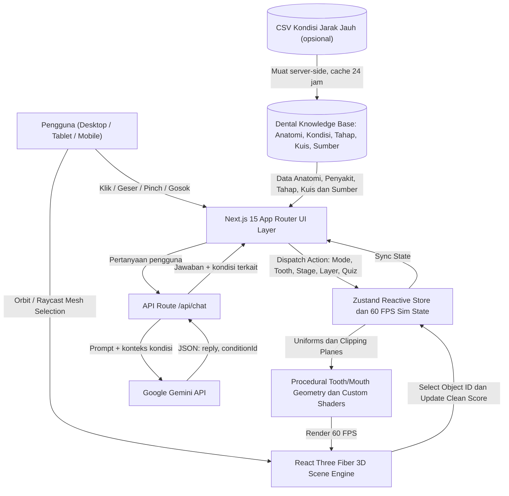
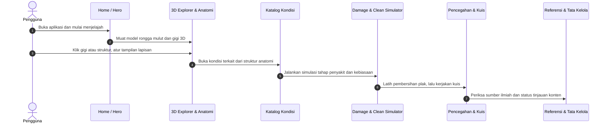

# DentaScope

**Dokumen Penyerahan Resmi Logicodix 2026 · Tim Sukses · Telkom University**

DentaScope adalah platform edukasi kesehatan gigi berbasis web. Pengguna dapat menjelajahi anatomi gigi dalam 3D, melihat bagaimana kerusakan berkembang, berlatih menyikat gigi, dan bertanya kepada asisten AI yang ikut mengarahkan kamera dan pose model 3D.

---

## Daftar Isi

1. [Identitas Tim & Anggota Resmi](#1-identitas-tim--anggota-resmi)
2. [Profil & Konsep Solusi](#2-profil--konsep-solusi)
3. [Daftar Fitur Utama (MVP)](#3-daftar-fitur-utama-mvp)
4. [Teknologi yang Digunakan](#4-teknologi-yang-digunakan)
5. [Diagram Arsitektur & Alur Data](#5-diagram-arsitektur--alur-data)
6. [Panduan Instalasi & Eksekusi](#6-panduan-instalasi--eksekusi)
7. [Akun Demonstrasi (Demo Credentials)](#7-akun-demonstrasi-demo-credentials)
8. [Dokumentasi Penggunaan AI](#8-dokumentasi-penggunaan-ai)
9. [Atribusi Sumber Daya Pihak Ketiga & Referensi Ilmiah](#9-atribusi-sumber-daya-pihak-ketiga--referensi-ilmiah)

---

## 1. Identitas Tim & Anggota Resmi

| | |
|---|---|
| **Nama Tim** | Tim Sukses |
| **Institusi** | Telkom University, Fakultas Rekayasa Industri |
| **Ketua Tim** | Muhammad Ahnaf Isa Hammam Lisualla |
| **Kontak Ketua** | +6281257366106 |

| No | Nama | NIM | Peran |
|:--:|---|---|---|
| 1 | Muhammad Ahnaf Isa Hammam Lisualla | n/a | Ketua Tim / Product & Strategy Lead |
| 2 | Muhammad Hafizh Farsya | 102022630036 | UI/UX & Frontend Engineer |
| 3 | M Alief Ma'rifatullah Az Zikry | 102022600457 | Medical Content Researcher |
| 4 | Muhammad Bevand Januartama | 103022630014 | Fullstack 3D Engine & AI Engineer |

---

## 2. Profil & Konsep Solusi

| | |
|---|---|
| **Kategori** | Web App |
| **Nama Aplikasi** | DentaScope |
| **Subtema** | Inclusive Health & Well-being |

### Masalah Nyata

Materi kesehatan gigi umumnya berupa teks dan gambar 2D statis. Format ini menyulitkan pembaca memahami hubungan ruang antara struktur dalam gigi (email, dentin, pulpa, sementum, ligamen periodontal, tulang alveolar) dan perkembangan penyakitnya.

Beban penyakit gigi dan mulut, terutama karies dan penyakit periodontal, masih tinggi menurut rujukan WHO dan Survei Kesehatan Indonesia (SKI) 2023 Kemenkes RI. Salah satu penyebabnya adalah rendahnya pemahaman tentang demineralisasi akibat asam, area interdental yang rawan plak, dan anggapan keliru bahwa kerusakan gigi terjadi seketika atau tidak bisa dicegah pada tahap awal (*white spot lesion*).

### Solusi

- **Eksplorasi 3D prosedural real-time.** Seluruh gigi dan jaringan sekitarnya dibangkitkan secara matematis, sehingga tidak membutuhkan berkas model eksternal yang berat.
- **Simulator kerusakan.** Pengguna dapat melihat tahapan karies dan periodontitis, serta kaitan kebiasaan makan dengan penurunan pH plak lewat Kurva Stephan.
- **Latihan sikat gigi 3D.** Pengguna membersihkan plak secara interaktif dengan sikat, benang gigi, dan pembersih lidah.
- **Asisten AI.** Pengguna bertanya dalam bahasa sehari-hari, dan model 3D langsung menampilkan kondisi yang dibahas.

### Target Pengguna

- **Primer:** pelajar, mahasiswa, dan masyarakat umum yang ingin memahami anatomi dan pencegahan penyakit gigi secara visual.
- **Sekunder:** edukator, penyuluh kesehatan, dan dokter gigi yang meninjau akurasi materi.

---

## 3. Daftar Fitur Utama (MVP)

| No | Fitur | Deskripsi | Status |
|:--:|---|---|:--:|
| 1 | **3D Dental Explorer** | 32 gigi bernomor FDI, 10 lapisan anatomi yang bisa dihidupkan/dimatikan, potongan melintang, pemilihan struktur lewat klik, dan hotspot interaktif yang memutar kamera ke bagian terkait | Selesai |
| 2 | **Katalog 21 Kondisi Gigi** | Penyakit, kelainan gigitan, gangguan tumbuh, kelainan struktur, dan kebiasaan. Setiap kondisi punya penjelasan awam, tanda-tanda, cara mencegah, sumber, serta deformasi pose 3D (gigi bergeser, miring, rahang menutup atau maju). Data tambahan dapat dimuat dari CSV jarak jauh dengan cache | Selesai |
| 3 | **Damage Simulator & Kurva Stephan** | Penggeser waktu untuk tahap karies dan periodontitis, skenario kebiasaan harian, dan kurva pH Stephan dengan ambang kritis 5,5 | Selesai |
| 4 | **3D Cleaning Lab** | Latihan menyikat gigi, benang gigi, dan pembersih lidah dengan skor kebersihan, timer 2 menit, dan tips teknik. Dioptimasi menargetkan 60 FPS | Selesai |
| 5 | **Kuis Interaktif** | Soal dengan umpan balik instan, pembahasan bersumber, navigasi keyboard, dan kamera yang diarahkan otomatis ke gigi terkait | Selesai |
| 6 | **Asisten Chat AI Gemini** | Tanya-jawab edukasi kesehatan gigi. Jawaban dapat disertai tombol "Lihat di model 3D" yang membuka kondisi dan pose terkait | Selesai |
| 7 | **Tata Kelola Konten & Dialog Sumber** | Dialog daftar rujukan ilmiah, dialog "Tentang konten ini" dengan status tinjauan materi, dan disclaimer medis | Selesai |

---

## 4. Teknologi yang Digunakan

| Lapisan | Teknologi |
|---|---|
| Framework | Next.js 15 (App Router), React 19, TypeScript |
| 3D | Three.js, React Three Fiber (`@react-three/fiber`), `@react-three/drei`, `camera-controls` |
| State | Zustand v5 |
| Animasi UI | Framer Motion |
| Styling | Tailwind CSS v4 |
| AI | Google Gemini API (`@google/genai`) |

---

## 5. Diagram Arsitektur & Alur Data

### A. Arsitektur Sistem



### B. Alur Perjalanan Pengguna



---

## 6. Panduan Instalasi & Eksekusi

### Prasyarat

- Node.js v18.18.0 atau lebih baru (disarankan v20 atau v22 LTS)
- npm

### Instalasi

```bash
git clone https://github.com/BevandJanuartama/logicodix-timsukses.git
cd logicodix-timsukses
npm install
```

### Konfigurasi Variabel Lingkungan

```bash
cp .env.example .env
```

| Variabel | Wajib | Fungsi |
|---|:---:|---|
| `GEMINI_API_KEY` | Hanya untuk chat AI | Kunci Gemini API. Hanya dibaca di server, tidak pernah dikirim ke peramban. Tanpa kunci ini, seluruh fitur lain tetap berjalan dan asisten chat menampilkan pesan ramah |
| `CONDITIONS_CSV_URL` | Opsional | URL CSV untuk menambah atau menimpa data kondisi gigi. Bila kosong atau gagal diakses, aplikasi memakai data bawaan. Templat: `docs/conditions-template.csv` |
| `NEXT_PUBLIC_APP_NAME` | Opsional | Nama aplikasi yang ditampilkan, mis. `DentaScope` |

### Menjalankan Aplikasi

```bash
npm run dev
```

Buka `http://localhost:3000`.

Untuk versi produksi:

```bash
npm run build && npm run start
```

Pemeriksaan tipe TypeScript: `npm run typecheck`.

---

## 7. Akun Demonstrasi (Demo Credentials)

Aplikasi berstatus **Public Open Access**. Tidak ada gerbang login, registrasi, maupun paywall, sehingga dewan juri dapat langsung menguji semua fitur tanpa kredensial.

Untuk keperluan penilaian, tombol **Sumber** di header membuka dialog rujukan ilmiah. Dialog **Tentang konten ini** menampilkan disclaimer medis, status tinjauan materi, dan bagian "Rincian untuk peninjau" berisi filter status, matriks aset 3D, serta celah riset yang masih terbuka.

---

## 8. Dokumentasi Penggunaan AI

| | |
|---|---|
| **Model** | Google Gemini API, `gemini-3.8-flash` (dapat diubah lewat `GEMINI_MODEL`) |
| **Pustaka** | `@google/genai` |

### Fungsi

Asisten tanya-jawab edukasi kesehatan gigi. Server meminta keluaran JSON terstruktur berisi `reply` dan `conditionId`. Bila jawaban menyangkut kondisi dalam katalog, antarmuka menampilkan tombol "Lihat di model 3D" yang membuka tab Kondisi, mengarahkan kamera, dan memasang pose kelainan gigi yang sesuai.

Konteks yang diberikan ke model adalah data kondisi aplikasi (data bawaan ditambah CSV bila ada), sehingga jawaban berpegang pada materi yang sama dengan yang dilihat pengguna.

### Etika & Keamanan

- **Menolak diagnosis pribadi.** Asisten tidak mendiagnosis keluhan individu dan mengarahkan pengguna ke dokter gigi atau layanan darurat bila situasinya berisiko.
- **Disclaimer medis.** Seluruh modul menegaskan bahwa visualisasi bersifat edukatif, bukan alat diagnosis mandiri maupun penilaian risiko pribadi.
- **Rate limiting di server.** Maksimal 20 permintaan per 10 menit per klien, 12 pesan per percakapan, dan 1000 karakter per pesan.
- **Kunci API terlindungi.** `GEMINI_API_KEY` hanya dipakai di route server.

---

## 9. Atribusi Sumber Daya Pihak Ketiga & Referensi Ilmiah

### A. Pustaka Open-Source & Tipografi

| Pustaka | Lisensi |
|---|---|
| Next.js, React | MIT |
| Three.js, `@react-three/fiber`, `@react-three/drei` | MIT |
| Zustand | MIT |
| Framer Motion, `camera-controls` | MIT |
| Tailwind CSS | MIT |
| Lucide React | ISC |
| `@google/genai` | Apache-2.0 |
| Newsreader (tipografi tampilan) | SIL OFL, via Google Fonts / `next/font` |
| Atkinson Hyperlegible Next (tipografi teks) | SIL OFL, via Google Fonts / `next/font` |

Mesin geometri prosedural dan sebagian konten skenario diadaptasi dari proyek referensi internal tim, `dentascope`.

### B. Referensi Ilmiah & Medis Resmi (16 Sumber)

1. World Health Organization. *Oral health.* https://www.who.int/news-room/fact-sheets/detail/oral-health
2. World Health Organization. *Sugars and dental caries.* https://www.who.int/news-room/fact-sheets/detail/sugars-and-dental-caries
3. NCBI. *Anatomy, Head and Neck: Teeth.* https://www.ncbi.nlm.nih.gov/books/
4. NCBI. *Histology, Tooth.* https://www.ncbi.nlm.nih.gov/books/
5. NCBI. *Histology, Periodontium.* https://www.ncbi.nlm.nih.gov/books/
6. Pitts NB et al. *Dental caries.* Nature Reviews Disease Primers (2017), 3, 17030. https://doi.org/10.1038/nrdp.2017.30
7. Papapanou PN et al. *Periodontitis: Consensus report of workgroup 2 of the 2017 World Workshop.* J Clin Periodontol (2018).
8. International Caries Classification and Management System (ICCMS). https://www.iccms-web.com/
9. CDC. *About Periodontal (Gum) Disease.* https://www.cdc.gov/oral-health/about/gum-periodontal-disease.html
10. Kementerian Kesehatan RI. *Survei Kesehatan Indonesia (SKI) 2023, Laporan Tematik Kesehatan Gigi dan Mulut.* https://www.badankebijakan.kemkes.go.id/
11. American Dental Association. *MouthHealthy: dental topics and tooth anatomy resources.* https://www.mouthhealthy.org/
12. Queen Mary University of London. *Atlas of tooth development and eruption.* https://www.qmul.ac.uk/dentistry/
13. American Association of Orthodontists (AAO). Rujukan kelainan gigitan dan susunan gigi.
14. MedlinePlus. Rujukan kondisi gigi dan mulut.
15. NIH Genetic and Rare Diseases Information Center (GARD). Rujukan kelainan struktur gigi.
16. CDC. Rujukan fluorosis gigi.

---

## Catatan Keterbukaan

- Sebagian materi editorial **belum ditinjau dokter gigi**: tingkat perhatian per kondisi, peta fokus kuis, dan empat skenario Kurva Stephan. Antarmuka menyatakan hal ini secara terbuka lewat dialog "Tentang konten ini".
- Pose 3D pada kelainan gigitan dan susunan gigi adalah **ilustrasi**, bukan ukuran klinis.
- Angka 60 FPS merupakan target optimasi. Pengukuran otomatis belum dilakukan, dan pengujian di perangkat seluler nyata masih perlu dilengkapi.
- Asisten chat sudah diuji sampai ke penyedia API, tetapi belum dengan kunci produksi sungguhan.
