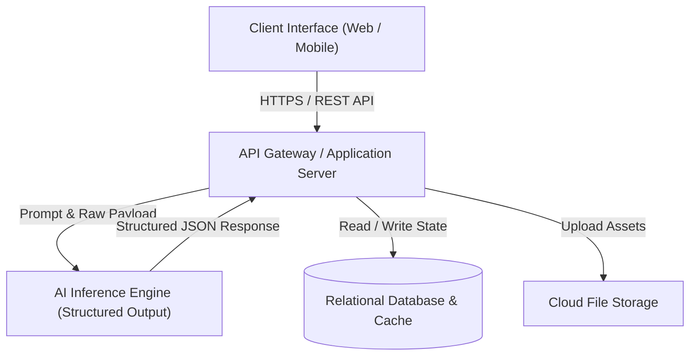
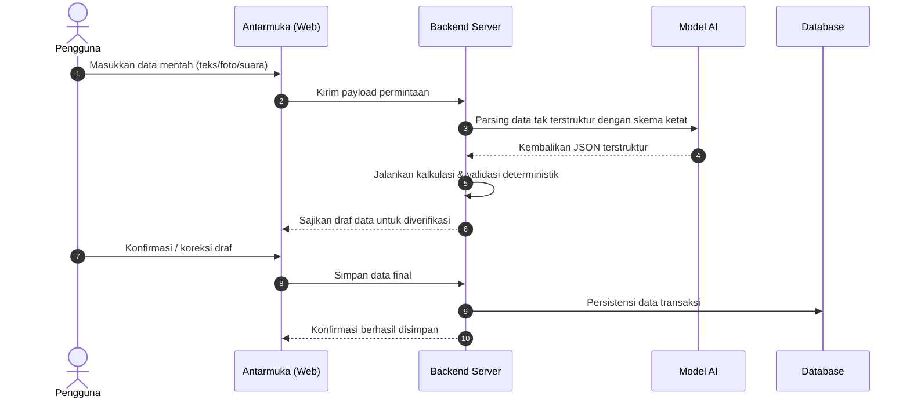

# DOKUMEN RANGKUMAN & SPESIFIKASI SUBMISSION LOGICODIX 2026
> **Status:** Living Document (Wajib diperbarui di setiap iterasi/prompting penambahan fitur, aset, dan konfigurasi)  
> **Standar Rujukan:** Guidebook LOGICODIX 2026 (Halaman 20 - Ketentuan Wajib Dokumentasi & Submission)

---

## 1. Identitas Tim & Anggota
* **Nama Tim:** Tim Sukses Logicodix
* **Daftar Anggota:**
  1. *[Nama Anggota 1]* - [Peran: misal Lead / Fullstack Developer]
  2. *[Nama Anggota 2]* - [Peran: misal UI/UX Designer / Frontend]
  3. *[Nama Anggota 3]* - [Peran: misal Backend & AI Engineer]
  4. *[Nama Anggota 4]* - [Peran: misal QA & Product Researcher]

---

## 2. Profil & Konsep Solusi Aplikasi
* **Kategori Aplikasi:** Web App *(atau Mobile App)*
* **Subtema:** *[Pendidikan / Lingkungan / UMKM / Kesehatan / Layanan Publik]*
* **Nama Aplikasi:** `[Nama Aplikasi]`
* **Masalah yang Diangkat:**
  * **Pernyataan Masalah:** `[Siapa]` perlu `[apa]`, tapi `[hambatan]`, sehingga `[akibat/titik macet nyata]`.
  * **Bukti di Lapangan:** Penjelasan singkat mengenai kendala nyata yang dialami pengguna pada sistem eksisting (misal pencatatan manual di buku, waktu proses yang lambat, kesalahan input).
* **Deskripsi Solusi:**
  * Penjelasan ringkas mengenai pendekatan solusi digital yang dibangun, bagaimana produk menyelesaikan titik macet utama tanpa menambah kerumitan bagi pengguna akhir.
* **Target Pengguna:**
  * Pengguna primer (end-user harian yang berinteraksi langsung dengan sistem).
  * Pengguna sekunder (pihak pengambil keputusan, supervisor, atau instansi terkait).

---

## 3. Daftar Fitur Utama (MVP Roadmap & Status)
*Catatan: Seluruh fitur di bawah wajib merefleksikan alur kerja end-to-end yang dapat diuji (dilarang menampilkan fitur fiktif).*

| No | Fitur Utama | Deskripsi Alur & Fungsi | Status Implementasi |
|:--:|---|---|:--:|
| 1 | **[Fitur Utama 1 / Input]** | Menangkap data masukan mentah dari pengguna | `[Selesai / Dalam Pengerjaan]` |
| 2 | **[Fitur Pemrosesan / AI Engine]** | Mengubah masukan tak terstruktur menjadi data terstruktur | `[Selesai / Dalam Pengerjaan]` |
| 3 | **[Fitur Verifikasi & Validasi]** | Memungkinkan pengguna meninjau dan mengoreksi hasil komputasi | `[Selesai / Dalam Pengerjaan]` |
| 4 | **[Fitur Output / Laporan / Eksekusi]** | Menyimpan, memvisualisasikan, atau mengekspor hasil ke format akhir | `[Selesai / Dalam Pengerjaan]` |

---

## 4. Arsitektur Teknologi (Tech Stack)
* **Frontend:**
  * Framework: React / Next.js / Vite
  * Styling & UI: Tailwind CSS, Radix UI / Shadcn UI
  * Motion & Interactivity: GSAP / Lucide Icons
* **Backend & API:**
  * Runtime / Framework: Node.js / Python FastAPI
  * API Architecture: RESTful API / RPC
* **Database & Penyimpanan:**
  * Database: PostgreSQL / SQLite / Supabase
  * ORM / Driver: Prisma / Drizzle / SQLAlchemy
* **Layanan AI & Model:**
  * Model / API: Google Gemini API (gemini-1.5-flash / gemini-2.5)
  * Format Ekstraksi: JSON Structured Output (Pydantic / TypeChat)
* **Layanan Pihak Ketiga & Hosting:**
  * Hosting Frontend & Backend: Vercel / Railway / Cloudflare
  * Media Storage: Cloudinary / S3-compatible

---

## 5. Diagram Arsitektur Sistem & Alur Data

### A. Diagram Arsitektur Sistem


### B. Alur Data End-to-End (Data Flow)


---

## 6. Panduan Instalasi, Konfigurasi & Menjalankan Aplikasi

### A. Prasyarat Sistem
* Node.js v18.0.0 atau lebih baru (atau Python 3.10+)
* Paket manajer: `npm`, `pnpm`, atau `yarn`
* Akses koneksi internet untuk mengunduh dependensi dan panggilan API AI

### B. Langkah Instalasi Dependensi
```bash
# 1. Kloning repositori
git clone https://github.com/[username-tim]/[nama-repo].git
cd [nama-repo]

# 2. Pasang paket dependensi
npm install
# atau jika menggunakan python:
# pip install -r requirements.txt
```

### C. Konfigurasi Variabel Lingkungan (`.env`)
Salin berkas `.env.example` menjadi `.env` lalu sesuaikan isinya:
```bash
cp .env.example .env
```

**Daftar Variabel Lingkungan (`.env.example`):**
| Nama Variabel | Wajib / Opsional | Deskripsi & Contoh Nilai |
|---|:---:|---|
| `PORT` | Opsional | Port lokal aplikasi (default: `3000` atau `8000`) |
| `DATABASE_URL` | Wajib | String koneksi database |
| `GEMINI_API_KEY` | Wajib | Kunci API resmi Google Gemini |
| `JWT_SECRET` | Kondisional | Kunci rahasia enkripsi sesi/token |
| `NEXT_PUBLIC_APP_URL` | Opsional | URL dasar domain deployment |

> **Perhatian Keamanan:** File `.env` asli dilarang keras di-commit ke repositori Git. Pastikan `.env` terdaftar di `.gitignore`.

### D. Menjalankan Aplikasi di Localhost
```bash
# Menjalankan server pengembangan (development)
npm run dev

# Membangun versi produksi (production build)
npm run build
npm run start
```
Akses aplikasi melalui peramban web di `http://localhost:3000`.

---

## 7. Akun Demonstrasi (Demo Credentials)
*Hanya jika aplikasi menerapkan sistem autentikasi / multi-role:*

| Role Pengguna | Email / Username | Password | Deskripsi Hak Akses |
|---|---|---|---|
| **Administrator / Petugas** | `admin@demo.local` | `DemoPass123!` | Akses dashboard rekapitulasi, monitoring, dan audit |
| **Pengguna Standar / Mitra** | `user@demo.local` | `DemoPass123!` | Akses input data harian, draf transaksi, dan profil |

---

## 8. Dokumentasi Penggunaan Artificial Intelligence (AI)

### A. Layanan & Model yang Digunakan
* **Provider:** Google Gemini API
* **Model:** `gemini-1.5-flash` / model terkait
* **Tujuan Penggunaan:** Mentransformasi masukan data tak terstruktur (bahasa natural yang tidak seragam) menjadi skema JSON dengan validasi tipe data yang ketat.

### B. Prinsip Pembagian Kerja
1. **Model AI:** Bertanggung jawab murni pada pemahaman semantik teks/dokumen dan ekstraksi entitas. Model dilarang mengambil keputusan finansial atau komputasi angka krusial.
2. **Kode Deterministik:** Bertanggung jawab penuh pada perhitungan matematis (total, diskon, akumulasi), validasi batasan sistem, dan aturan bisnis.
3. **Manusia:** Mengambil kendali penuh untuk meninjau draf sebelum disimpan permanen ke database.

### C. Format Prompt & Structured Output Schema
*Contoh kontrak data JSON yang diharapkan dari AI:*
```json
{
  "entity_name": "string",
  "items": [
    {
      "name": "string",
      "quantity": 0,
      "unit": "string"
    }
  ],
  "ambiguous_fields": ["array string jika ada data yang perlu diklarifikasi pengguna"],
  "confidence_score": 0.95
}
```

---

## 9. Atribusi Sumber Daya Pihak Ketiga

### A. Template UI & Pustaka Antarmuka
* Komponen UI: [Shadcn UI](https://ui.shadcn.com/) (Lisensi MIT)
* Pustaka Ikon: [Lucide React](https://lucide.dev/) (Lisensi ISC)
* Desain & Tipografi: [Inter / Plus Jakarta Sans] via Google Fonts (OFL)

### B. Dataset & API Publik
* *[Sebutkan jika menggunakan dataset publik pemerintah, BPS, atau API pihak ketiga]*

### C. Pustaka Kode Pihak Ketiga
* Seluruh pustaka eksternal yang diinstal melalui `package.json` tercantum secara transparan dan berlisensi terbuka (MIT/Apache 2.0/BSD).

---

## 10. Log Pembaruan Dokumen (Changelog)
*Dokumen ini wajib dimutakhirkan secara konsisten setiap kali terjadi perubahan:*

| Versi | Tanggal | Bagian yang Diperbarui | Keterangan Perubahan |
|:---:|:---:|---|---|
| `v0.1.0` | 11/11/2026 | Inisialisasi Berkas | Pembuatan struktur panduan rujukan resmi submission |
| `v0.1.1` | 12/11/2026 | Integrasi Tooling & MCP | Konfigurasi Model Context Protocol (MCP) GitHub via `@modelcontextprotocol/server-github` dan autentikasi akun BevandJanuartama |

