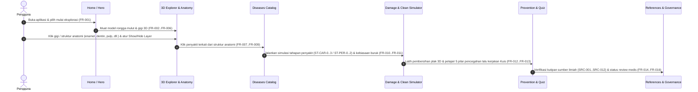

# DOKUMEN RANGKUMAN & SPESIFIKASI SUBMISSION LOGICODIX 2026
> **Status:** Living Document (Wajib diperbarui di setiap iterasi/prompting penambahan fitur, aset, dan konfigurasi)  
> **Standar Rujukan:** Guidebook LOGICODIX 2026 (Halaman 20 - Ketentuan Wajib Dokumentasi & Submission)

---

## 1. Identitas Tim & Anggota
* **Nama Tim:** Tim Sukses Logicodix
* **Daftar Anggota:**
  1. **Muhammad Bevand Januartama** (`BevandJanuartama`) - Lead & Fullstack 3D Developer
  2. *[Nama Anggota 2]* - UI/UX Designer & Frontend Engineer
  3. *[Nama Anggota 3]* - Medical Content & Knowledge Base Researcher
  4. *[Nama Anggota 4]* - QA & Product Researcher

---

## 2. Profil & Konsep Solusi Aplikasi
* **Kategori Aplikasi:** Web App (Interactive 3D Educational Platform)
* **Subtema:** Pendidikan & Kesehatan (*Health & Medical Education*)
* **Nama Aplikasi:** **Dental Explorer (DentaScope 3D)**
* **Masalah yang Diangkat:**
  * **Pernyataan Masalah:** Pelajar, mahasiswa, dan masyarakat umum membutuhkan media edukasi kesehatan gigi yang menyajikan anatomi, penyakit, faktor risiko, dan pencegahan secara terstruktur serta mudah dieksplorasi, tetapi materi konvensional berupa teks dan gambar statis 2D menyulitkan pengguna memahami hubungan spasial antara struktur internal gigi (email, dentin, pulpa, sementum, ligamen periodontal, tulang alveolar) dengan progresi penyakit.
  * **Bukti di Lapangan:** Berdasarkan rujukan WHO (*Oral Health Fact Sheet*) dan Survei Kesehatan Indonesia (SKI) 2023 Kemenkes RI (`SRC-001`, `SRC-010`), beban penyakit gigi dan mulut (khususnya karies dan penyakit periodontal) masih sangat tinggi akibat rendahnya literasi mengenai demineralisasi asam, area rawan plak interdental, serta anggapan keliru bahwa kerusakan gigi bersifat instan atau tidak dapat dicegah pada tahap awal (*white spot lesion*).
* **Deskripsi Solusi:**
  * **Dental Explorer (DentaScope 3D)** adalah platform edukasi kesehatan gigi berbasis web dengan pendekatan visual *hybrid*: menggabungkan model anatomi rongga mulut & gigi 3D prosedural interaktif (dari skala Makro lengkung rahang 32 gigi FDI, Meso fokus gigi, hingga Mikro penampang melintang/*cross-section*) dengan lapisan berwarna, kontrol visibilitas layer, katalog 10 penyakit gigi terverifikasi, *Damage Simulator* (simulasi tahapan klinis Karies `ST-CAR-0..3` & Periodontitis `ST-PER-0..2` serta kebiasaan buruk & Kurva pH Stephan), *Cleaning Simulator* (latihan menyikat gigi, flossing, dan pembersih lidah real-time), materi 5 pilar pencegahan, kuis interaktif, serta sistem tata kelola referensi ilmiah (`SRC-001` s/d `SRC-012`).
* **Target Pengguna:**
  * **Pengguna Primer:** Pelajar, mahasiswa kedokteran gigi/kesehatan, dan masyarakat umum yang ingin mempelajari anatomi serta pencegahan penyakit gigi secara visual.
  * **Pengguna Sekunder:** Tenaga pendidik, penyuluh kesehatan gigi, dan reviewer medis (dokter gigi) yang meninjau akurasi materi edukasi (`Draft | Under Review | Approved`).

---

## 3. Daftar Fitur Utama (MVP Roadmap & Status)
*Catatan: Seluruh fitur di bawah merefleksikan kebutuhan fungsional PRD (`FR-001` s/d `FR-016`) dan Knowledge Base (`03_Dental_Knowledge_Base.xlsx`).*

| No | Fitur Utama | Modul PRD | Deskripsi Alur & Fungsi | Status Implementasi |
|:--:|---|---|---|:--:|
| 1 | **Home & Quick Mode Switcher** | `FR-001` | Pengenalan produk dengan antarmuka *Clean Medical Tech Glassmorphism* dan navigasi cepat antar-modul | `Selesai (Fase 3)` — Hero + tab Anatomi/Penyakit; tab Simulator/Kuis menyusul Fase 4–5 |
| 2 | **3D Dental & Mouth Explorer (LOD Makro–Meso–Mikro)** | `FR-002`..`FR-006` | Eksplorasi 3D 32 gigi (FDI), *rotate/zoom/pan/reset*, pemilih mesh berdasarkan object ID, *cutaway cross-section*, dan *Show/Hide Layer Anatomi* | `Selesai (Fase 2)` — engine 3D, raycast 10 struktur + 7 zona rongga mulut, toggle 10 lapisan, cutaway |
| 3 | **Katalog Anatomi & Klasifikasi Jenis Gigi** | `FR-007` | Informasi mendalam 10 struktur (`AN-001` Enamel s/d `AN-010` CEJ) & 4 jenis gigi (`TT-001`..`TT-004` sulung vs permanen) beserta meter kerentanan | `Selesai (Fase 3)` — tanpa meter kerentanan (tidak ada di Knowledge Base) |
| 4 | **Katalog 10 Penyakit & Kondisi Gigi** | `FR-008`..`FR-009` | Direktori `DIS-001` s/d `DIS-010` lengkap dengan definisi, faktor risiko, gejala umum, bagian terdampak, pencegahan, *safety note*, dan rujukan `SRC-xxx` | `Selesai (Fase 3)` — + tombol "Lihat di 3D"; "Buka Simulator" di Fase 4 |
| 5 | **Damage Simulator (Tahapan Klinis & Kebiasaan)** | `FR-010`..`FR-011` | Visualisasi tahapan karies (`ST-CAR-0..3`), periodontitis (`ST-PER-0..2`), skenario es batu, bruxism, boba (Kurva pH Stephan), & merokok pada model 3D | `Selesai (Fase 4)` — partikel es & bakteri belum diport |
| 6 | **3D Cleaning Simulator & 5 Pilar Pencegahan** | `FR-012` | Simulasi interaktif membersihkan plak dengan sikat gigi, benang gigi, & pembersih lidah real-time + materi edukasi `PRE-001`..`PRE-005` | `Selesai (Fase 4)` |
| 7 | **Interactive Dental Quiz** | `FR-013` | Kuis evaluasi pemahaman anatomi, penyakit, dan pencegahan dilengkapi skor langsung, pembahasan, dan tautan referensi | `Selesai (Fase 5)` |
| 8 | **Content Governance & Scientific References** | `FR-014`..`FR-016` | Panel referensi ilmiah (`SRC-001`..`SRC-012`), status review (`Draft`, `Under Review`, `Approved`), registri aset 3D (`AST-001`..`AST-004`), & *Medical Disclaimer* | `Selesai (Fase 5)` — perubahan status disimpan lokal di peramban |

---

## 4. Arsitektur Teknologi (Tech Stack)
* **Frontend & 3D Engine:**
  * Framework: **Next.js 15** (App Router) + **React 19** + **TypeScript 5.9**
  * 3D Rendering: **Three.js (`0.180`)** + **React Three Fiber (`@react-three/fiber` v9)** + **`@react-three/drei` v10** (Procedural Geometry + Custom GLSL Shaders + Local Clipping Planes + `InstancedMesh` + `PerformanceMonitor`)
  * State Management: **Zustand v5** (Reactive UI store + non-reactive 60 FPS simulation state `sim.ts`)
  * Styling & UI: **Tailwind CSS v4** (`@tailwindcss/postcss`) + Custom Glassmorphism Design System (`Plus Jakarta Sans`)
  * Motion & UI Components: **framer-motion** + komponen dari **21st.dev** (shadcn registry, di-restyle ke token desain)
  * Iconography: **Lucide React** + Custom Clinical Dental SVG Icons
* **Data & Knowledge Base Architecture:**
  * Structured Seed Dataset: TypeScript Knowledge Base (`lib/knowledgeBase.ts` + `lib/data/*.ts`, dihasilkan dari xlsx; kuis diperkaya menjadi 8 soal berstatus `Draft`) yang mengimplementasikan seluruh 11 tabel dari `03_Dental_Knowledge_Base.xlsx` (`tooth_structures`, `tooth_types`, `dental_diseases`, `disease_stages`, `prevention_topics`, `dental_models`, `quiz_questions`, `sources`, `research_gaps`).
* **Deployment & Hosting:**
  * Platform: Vercel / Node.js Server (`npm run build && npm run start`)

---

## 5. Diagram Arsitektur Sistem & Alur Data

### A. Diagram Arsitektur Sistem
```mermaid
graph TD
    User["Pengguna (Desktop / Tablet / Mobile)"]
    UI["Next.js 15 App Router UI Layer (.glass HUD)"]
    Store["Zustand Reactive Store & 60FPS Sim State"]
    R3F["React Three Fiber 3D Scene Engine"]
    Proc["Procedural Tooth/Mouth Geometry & Custom Shaders"]
    KB[("Dental Knowledge Base (AN / TT / DIS / ST / PRE / SRC)")]

    User -->|Klik / Geser / Pinch / Gosok| UI
    User -->|Orbit / Raycast Mesh Selection| R3F
    UI -->|Dispatch Action (Mode, Tooth, Stage, Layer, Quiz)| Store
    R3F -->|Select Object ID & Update LOD/Clean Score| Store
    Store -->|Sync State| UI
    Store -->|Uniforms & Clipping Planes| Proc
    Proc -->|Render 60 FPS| R3F
    KB -->|Data Anatomi, Penyakit, Tahap, Kuis & Sumber| UI
```

### B. Alur Perjalanan Pengguna (User Journey sesuai PRD Bagian 6)


---

## 6. Panduan Instalasi, Konfigurasi & Menjalankan Aplikasi

### A. Prasyarat Sistem
* Node.js v18.18.0 atau lebih baru (disarankan v20 atau v22 LTS)
* Paket manajer: `npm`

### B. Langkah Instalasi Dependensi
```bash
# 1. Kloning repositori
git clone https://github.com/BevandJanuartama/logicodix-timsukses.git
cd logicodix-timsukses

# 2. Pasang paket dependensi
npm install
```

### C. Konfigurasi Variabel Lingkungan (`.env.example`)
Aplikasi berjalan secara *self-contained* tanpa ketergantungan kunci API berbayar saat runtime agar dapat diuji secara instan oleh dewan juri:
```bash
cp .env.example .env
```

| Nama Variabel | Wajib / Opsional | Deskripsi & Contoh Nilai |
|---|:---:|---|
| `NEXT_PUBLIC_APP_NAME` | Opsional | Nama aplikasi (`Dental Explorer 3D`) |
| `NEXT_PUBLIC_DEFAULT_REVIEW_FILTER` | Opsional | Filter tata kelola konten (`all` atau `Approved`) |

### D. Menjalankan Aplikasi di Localhost
```bash
# Menjalankan server pengembangan (development)
npm run dev

# Memeriksa tipe TypeScript
npm run typecheck

# Membangun dan menjalankan versi produksi (production build)
npm run build
npm run start
```
Akses aplikasi melalui peramban web di `http://localhost:3000`.

---

## 7. Tata Kelola Konten (Content Governance & Review Mode)
Sesuai kebutuhan `FR-014` dan `FR-015` pada PRD, aplikasi menyertakan fitur **Content Governance & Admin Inspector** yang dapat diakses langsung dari bilah atas tanpa memerlukan login kredensial eksternal:
* **Status Editorial (`review_status`):** Setiap item anatomi, penyakit, tahapan simulasi, dan soal kuis memiliki status `Approved`, `Under Review`, atau `Draft`.
* **Reviewer Mode Toggle:** Pengguna/juri dapat mengalihkan tampilan antara seluruh konten dataset atau memfilter khusus konten berstatus `Approved` serta memeriksa matriks aset 3D (`AST-001`..`AST-004`) dan *Research Gaps* (`GAP-001`..`GAP-006`).

---

## 8. Dokumentasi Arsitektur Komputasi & Visualisasi Prosedural
1. **3D Prosedural Tanpa Beban Aset Eksternal (`NFR-001`):** Seluruh 32 gigi (seri, taring, premolar, geraham) beserta lapisan internal (`enamel`, `dentin`, `pulp` dengan pembuluh arteri/vena/saraf, `cementum`, `pd_ligament`, `alveolar_bone`, `gingiva`, dan lidah) dibangkitkan secara matematis/prosedural menggunakan *lathe profiles* dan *custom GLSL shaders*, menghasilkan waktu muat instan dan performa 60 FPS di perangkat mobile maupun desktop.
2. **Simulasi Biokimia & Klinis Deterministik:** Perhitungan kurva demineralisasi pH plak (Kurva Stephan dengan ambang kritis pH 5,5) serta interpolasi tahapan kerusakan (`ST-CAR-0..3` & `ST-PER-0..2`) dihitung secara deterministik berdasarkan rujukan ilmiah.
3. **Pemetaan Object ID 3D → Knowledge Base (`FR-004`):** Raycast memetakan mesh ke `AN-001..010` (`enamel` = mahkota luar, `cementum` = akar luar, `pulp_chamber`/`root_canal` = rongga pulpa di atas/bawah CEJ, `pulp` = pembuluh & saraf, `cej` = cincin batas email–sementum, `pd_ligament` = cangkang tipis di sekitar akar) serta zona papila, palatum, dasar mulut, dan 4 zona lidah. Lapisan tersembunyi dibuang di shader (`discard` per pita CEJ) dan dilewati raycast sehingga lapisan di bawahnya tetap dapat diklik.
4. **Anggaran Render:** ±41 draw call dan ±58 ribu segitiga per frame pada tampilan makro; geometri prosedural di-cache per gigi, resolusi tinggi hanya untuk gigi terpilih, DPR adaptif via `PerformanceMonitor`.
5. **Batas Keamanan Medis (`NFR-006`):** Seluruh modul menampilkan *Medical Disclaimer* bahwa visualisasi bersifat edukatif dan bukan alat diagnosis mandiri maupun *personal risk scoring*.
6. **Redesign Visual Fase 7 (Geometri Anatomi, Shader Jaringan & Studio Lighting):**
   * **Morfologi mahkota** (`lib/three/crownMorphology.ts`): cusp, fisura, fossa sentral, cingulum, dan marginal ridge dibentuk lewat deformasi vertex prosedural. **Akar** (`lib/three/toothRoots.ts`): bifurkasi/trifurkasi gigi anterior vs posterior (`TT-001..004`) dengan alur furkasi.
   * **Kontur CEJ** (`lib/three/cejContour.ts`): kurva batas email–sementum per jenis gigi, dirender lewat GLSL `CEJ_GLSL`.
   * **Shader email & dentin** (`lib/three/toothShader.ts`, `lib/three/toothOptics.ts`): aproksimasi *subsurface scattering* untuk translusensi mutiara, Fresnel rim-light, dan micro-roughness (`AN-001`, `AN-002`).
   * **Shader gusi** (`lib/three/gingivaShader.ts`, `lib/three/softTissue.ts`): specular *wetness* saliva (Schlick Fresnel) dan rona sehat vs meradang lewat `uGumInflammation` (`AN-010`).
   * **Studio lighting** (`components/three/StudioLights.tsx`): rig tiga titik (key hangat-putih, cool rim dari belakang, warm fill) ditambah hemisphere light; rig berotasi mengikuti azimuth kamera dengan damping.

---

## 9. Atribusi Sumber Daya & Referensi Ilmiah (`SRC-001` s/d `SRC-012`)

### A. Pustaka Kode Pihak Ketiga
* **Next.js & React** (Lisensi MIT)
* **Three.js, `@react-three/fiber`, `@react-three/drei`** (Lisensi MIT)
* **Zustand** (Lisensi MIT)
* **framer-motion & camera-controls** (Lisensi MIT)
* **Engine prosedural & konten skenario** diadaptasi dari proyek referensi `D:\test-bepan\dentascope`
* **Tailwind CSS v4 & Lucide React** (Lisensi MIT / ISC)
* **Tipografi:** `Plus Jakarta Sans` via Google Fonts (OFL)

### B. Referensi Ilmiah & Medis Resmi (Sesuai `01_Dental_Research` & `03_Dental_Knowledge_Base`)
* **`SRC-001`** — World Health Organization (WHO). *Oral health*. https://www.who.int/news-room/fact-sheets/detail/oral-health
* **`SRC-002`** — World Health Organization (WHO). *Sugars and dental caries*. https://www.who.int/news-room/fact-sheets/detail/sugars-and-dental-caries
* **`SRC-003`** — National Center for Biotechnology Information (NCBI). *Anatomy, Head and Neck: Teeth*. https://www.ncbi.nlm.nih.gov/books/
* **`SRC-004`** — National Center for Biotechnology Information (NCBI). *Histology, Tooth*. https://www.ncbi.nlm.nih.gov/books/
* **`SRC-005`** — National Center for Biotechnology Information (NCBI). *Histology, Periodontium*. https://www.ncbi.nlm.nih.gov/books/
* **`SRC-006`** — Pitts NB et al. *Dental caries*. Nature Reviews Disease Primers (2017), 3, 17030. https://doi.org/10.1038/nrdp.2017.30
* **`SRC-007`** — Papapanou PN et al. *Periodontitis: Consensus report of workgroup 2 of the 2017 World Workshop*. J Clin Periodontol (2018).
* **`SRC-008`** — International Caries Classification and Management System (ICCMS). *ICCMS Guide / resources*. https://www.iccms-web.com/
* **`SRC-009`** — Centers for Disease Control and Prevention (CDC). *About Periodontal (Gum) Disease*. https://www.cdc.gov/oral-health/about/gum-periodontal-disease.html
* **`SRC-010`** — Kementerian Kesehatan Republik Indonesia. *Survei Kesehatan Indonesia (SKI) 2023 — Laporan Tematik Kesehatan Gigi dan Mulut*. https://www.badankebijakan.kemkes.go.id/
* **`SRC-011`** — American Dental Association (ADA). *MouthHealthy / Dental topics and tooth anatomy resources*. https://www.mouthhealthy.org/
* **`SRC-012`** — Queen Mary University of London. *Atlas of tooth development and eruption*. https://www.qmul.ac.uk/dentistry/

---

## 10. Log Pembaruan Dokumen (Changelog)
*Dokumen ini wajib dimutakhirkan secara konsisten setiap kali terjadi perubahan:*

| Versi | Tanggal | Bagian yang Diperbarui | Keterangan Perubahan |
|:---:|:---:|---|---|
| `v0.1.0` | 11/11/2026 | Inisialisasi Berkas | Pembuatan struktur panduan rujukan resmi submission |
| `v0.1.1` | 12/11/2026 | Integrasi Tooling & MCP | Konfigurasi Model Context Protocol (MCP) GitHub via `@modelcontextprotocol/server-github` dan autentikasi akun BevandJanuartama |
| `v0.2.0` | 12/11/2026 | Perencanaan Produk, Riset & Arsitektur | Sinkronisasi PRD (`02_Dental_Explorer_PRD`), Research (`01_Dental_Research`), Knowledge Base (`03_Dental_Knowledge_Base.xlsx`), dan referensi visual `dentascope` ke dalam `PLAN.md`, `TASK.md`, serta `rangkuman.md` |
| `v0.2.1` | 12/11/2026 | Rencana UI Motion & Strategi Model | Menambah layer UI 21st.dev (shadcn CLI / 21st MCP) + `framer-motion` ke `PLAN.md` §7, strategi model Haiku/Sonnet/Opus & hemat token §8, serta rekomendasi model + skill per subtask di `TASK.md` |
| `v0.3.0` | 12/11/2026 | Fase 1: Foundation | Scaffold Next.js 15 + Tailwind v4 + R3F + Zustand + `framer-motion`; tema `.bg-app`/`.glass`; `lib/types.ts`, `lib/data/*` (10 anatomi, 4 jenis gigi, 10 penyakit, 7 tahap, 5 pencegahan, 4 aset, 8 kuis, 12 referensi, 6 gap), `lib/store.ts`; typecheck & build lulus |
| `v0.4.0` | 12/11/2026 | Fase 2: 3D Engine & Layer Visibility | Port engine prosedural `dentascope` ke `lib/three/*` & `components/three/*` (layout FDI, geometri lathe, shader lapisan, jaringan lunak, clipping); mesh baru `pd_ligament` & `cej`; pemisahan `enamel`/`cementum` dan `pulp_chamber`/`root_canal` via shader; raycast AN-001..010 + highlight; toggle 10 lapisan (`LayerToggles`) & cutaway (`SceneInspector`); store: hover, LOD, cutaway, perintah kamera; typecheck lulus, diuji di browser 1440px & 375px |
| `v0.5.0` | 12/11/2026 | Fase 3: Shell, Anatomi & Penyakit | `components/ui/shell/*` (TopBar tab animasi `layoutId`, Hero, ViewControls, LodIndicator, HoverTip, Panel glass + bottom-sheet drag), `components/ui/explore/*` (intro, detail struktur AN, zona rongga mulut, ringkasan gigi + tabel TT, toggle lapisan), `components/ui/diseases/*` (katalog 10 penyakit, filter kategori/struktur, sumber SRC, Lihat di 3D); data baru `lib/data/oralRegions.ts` (konten zona mulut dari `dentascope`), `lib/data/diseaseLinks.ts` (pemetaan penyakit → struktur & fokus kamera, diturunkan dari kolom *affected structures*); store `intro`; tanpa dependensi baru |
| `v0.6.0` | 12/11/2026 | Fase 4: Simulator & Pembersihan | Store baru `lib/simulatorStore.ts` & `lib/cleaningStore.ts`; engine efek `lib/three/toothShader.ts`, `toothEffects.ts`, `cleaning.ts`, `math.ts`; komponen 3D `simulation/*` (SimulationClock, TartarLayer) & `cleaning/*` (PlaqueLayer, ToolCursor, CleaningController); UI `simulator/*` (tahap ST-CAR/ST-PER dari KB, 4 skenario kebiasaan, Kurva Stephan) & `clean/*` (skor, alat, obat kumur, toast, 5 Pilar Pencegahan); data `lib/data/habitScenarios.ts` (konten skenario dari `dentascope`); tab Simulasi & Bersihkan; dependensi langsung baru `camera-controls@^3.1.2` (sebelumnya transitif via drei) |
| `v0.7.0` | 12/11/2026 | Fase 5: Kuis, Referensi & Tata Kelola | `components/ui/quiz/*` (8 soal KB, umpan balik, skor, pembahasan + SRC), `components/ui/library/*` (dialog Referensi 12 SRC, dialog Tata Kelola: disclaimer, status konten + ubah status, AST, GAP), `Dialog` native, `LibraryMenu`, `StatusBadge` di semua kartu; store `lib/quizStore.ts`, `lib/governanceStore.ts` (localStorage key `dental-explorer-review-status`), `lib/data/contentRegistry.ts`; token warna `--color-amber-ink`, `--color-mint-ink`; tanpa dependensi baru |
| `v0.8.0` | 12/11/2026 | Fase 6: Verifikasi & Hardening | Audit: 0 komentar/dead code, `typecheck` & `build` lulus (statis, `/` 288 kB First Load JS). Perbaikan: `next.config.mjs` + `outputFileTracingRoot` (hilangkan peringatan multi-lockfile), `app/icon.svg` (favicon 404), `aria-label` tombol beranda memuat teks terlihat, TopBar muat di 360–375px (padding, label tab aktif disembunyikan <400px, tombol Library 40px), `Dialog` memakai `useId` (id judul unik). Lighthouse (headless, WebGL perangkat lunak): aksesibilitas 100, SEO 100, best-practices 96, performa 60 mobile / 83 desktop (TBT dominan dari render WebGL SwiftShader); review kode level high: 6 temuan, 2 diperbaiki. Tanpa dependensi atau aset baru |
| `v0.9.0` | 12/11/2026 | Penambahan Fase Redesign Baru (Fase 7–11) | Penambahan Fase Baru (Fase 7 s.d. Fase 11) di `.agents/plan/PLAN.md` (§9) dan `.agents/plan/TASK.md` (Bagian II) untuk Redesign Model 3D & UI Anti-Slop berbasis *discovery skill* (`taste-skill`, `ui-ux-pro-max`, `impeccable`, `ui-styling`, `emil-design-eng`, `threejs-react-three-fiber`) dengan penanda model per subtask (Haiku / Sonnet / Opus) untuk penghematan token, serta mempertahankan riwayat Fase 0–6 secara utuh |
| `v1.0.0` | 12/11/2026 | Fase 7: Redesign Model 3D, Shaders & Studio Lighting | Redesign shader anatomi 3D (enamel SSS, Fresnel rim-light, pulpa vaskular, gusi wetness), CEJ contouring, lighting studio 3-titik, transisi kamera halus; penyertaan kode baseline kuis (`components/ui/quiz/*`), pustaka referensi & tata kelola (`components/ui/library/*`), serta integrasi shell (`components/Experience.tsx`, `app/page.tsx`); sinkronisasi TASK.md & rangkuman.md |
| `v0.10.0` | 12/11/2026 | Fase 7: Redesign Model 3D, Shader & Studio Lighting | Geometri anatomi diperhalus (`crownMorphology.ts`, `toothRoots.ts`, `cejContour.ts`, `softTissue.ts`); shader email/dentin (`toothShader.ts`, `toothOptics.ts`) dan gusi (`gingivaShader.ts`); rig studio 3-titik (`StudioLights.tsx`); audit: 0 komentar kode, `typecheck` lulus; tanpa dependensi atau aset baru |
